## Introduction

Population ageing is one of the most important structural challenges facing advanced economies. As longevity increases and the share of older individuals rises, public pension systems come under growing pressure. Governments are therefore repeatedly called upon to reform pension arrangements in order to preserve fiscal sustainability, extend working lives, and adapt retirement systems to demographic change. These reforms are politically salient and economically consequential: they affect not only public finances, but also labour supply, household income, consumption, savings, investment, and aggregate output.

Yet the macroeconomic effects of pension reforms remain difficult to assess. Pension reforms are multidimensional policy interventions. Some reforms raise statutory retirement ages or tighten early-retirement rules, thereby directly affecting the timing of labour market exit. Others modify contribution requirements, benefit formulas, indexation rules, or the balance between pay-as-you-go and funded pension pillars. These instruments are often bundled within broader reform packages, phased in over long periods, and implemented in macroeconomic environments that may themselves influence reform decisions. As a result, identifying the causal effects of pension reforms requires both detailed institutional information and an empirical strategy capable of distinguishing between different reform channels.

Most of the existing literature has focused on the labour-market effects of pension reforms, especially the response of older workers to changes in retirement incentives. A large body of evidence shows that retirement behaviour is highly responsive to institutional rules governing eligibility ages, benefit accrual, and early-retirement provisions [@GruberWise1999]. More recent empirical work provides causal evidence on the effects of increasing retirement ages: @StaubliZweimuller2013 show that raising the early retirement age significantly increases employment among older workers.[^1] Recent work has also emphasised the importance of implementation lags and anticipation effects. In particular, @BiZubairy2023 show that restrictive pension reforms may have very different effects depending on whether they are implemented immediately or phased in over a long horizon: while immediate reforms tend to increase labour force participation among older workers, long phase-in periods may induce early exits as workers attempt to lock in pre-reform benefits. These findings highlight that timing and design are central to understanding the effects of pension reforms.

[^1]: The labour-supply response to retirement-age reforms is not mechanical. Empirical evidence also shows that increases in retirement ages may generate short-run adjustment costs: while some workers remain employed for longer, others who would otherwise have claimed pension benefits remain in unemployment, inactivity, or disability for longer periods [@Rabate2020; @Dubois2016; @Leduigou2016]. At the aggregate level, however, the evidence does not support the view that delayed retirement crowds out employment opportunities for younger workers. Cross-country and country-specific studies generally find that employment among older and younger workers tends to move together rather than in opposite directions [@MunnellWu2012; @Wise2017; @Kalwij2010; @BenSalem2010]. This suggests that the macroeconomic effects of retirement-age reforms depend not only on mechanical labour-force participation effects, but also on the response of aggregate demand, labour demand, and firms’ adjustment margins.

By contrast, less is known about the broader macroeconomic consequences of pension reforms. Beyond labour supply, reforms may affect aggregate demand through changes in household income and expected pension wealth; they may influence savings and investment through intertemporal substitution and capital accumulation; and they may alter fiscal space through changes in pension expenditure and public debt. Moreover, different reform instruments may operate through opposite channels: raising the retirement age can be interpreted as a positive labour-supply shock that increases productive capacity and labour income, while shifting toward funded private pension schemes may instead compress current consumption, generate transition costs for the public sector, and only gradually affect capital accumulation.[^2]

[^2]: Macroeconomic models and institutional syntheses also emphasise that the different levers used to restore pension-system balance operate through distinct channels [@COR2026MacroLeviers]. Increases in contribution rates tend to affect the labour tax wedge, disposable income, production costs, and ultimately employment and output. Changes in pension benefits primarily affect retirees’ disposable income and aggregate consumption in the short run, but may also induce life-cycle responses through savings and labour supply. By contrast, increases in retirement ages act primarily as positive labour-supply shocks, raising employment, potential output, and fiscal space over the medium run [@HvidingMerette1998; @KaramMuirPereiraTuladhar2010; @Morgavi2024; @COR2026MacroLeviers]. These mechanisms call for an empirical framework that can distinguish across reform instruments rather than treating pension reforms as a single homogeneous shock.

This paper studies the dynamic macroeconomic effects of pension reforms in advanced economies. We make three contributions. First, we construct a new narrative database of major pension reforms for 17 OECD countries over the period 1980-2025, building on the narrative approach to policy shocks and on recent pension reform datasets [@Ramey2009; @RomerRomer2010; @Beetsma2020; @BiZubairy2023; @romp_political_2024]. The database measures the timing, magnitude, and annual phase-in of reforms across statutory retirement ages, early-retirement rules, contribution requirements, and private pension pillars. This allows us to go beyond standard dummy-based measures of pension reforms and to capture both the magnitude and the annual phase-in of policy changes.

Second, we propose a parsimonious characterization of pension reforms using a conditional factor analysis. Pension systems are described by several policy variables, which often move together as part of broader reform packages. We summarize this information into two orthogonal dimensions, net of the business cycle. <!-- \sout{The first factor, labelled the \emph{Age} factor, captures reforms that delay retirement by raising statutory or early-retirement ages.} --> The first factor, labelled the *Age* factor, allows us to capture age-related reforms, most often delaying retirement by raising statutory or early-retirement ages. The second factor, labelled the *Capitalisation* factor, is related to shifts toward funded private pension schemes. This decomposition makes it possible to distinguish between reforms that primarily affect the timing of retirement and reforms that alter the financing structure of pension systems. Our main analysis focuses on the *Age* factor, while estimates for the *Capitalisation* factor are treated as complementary, given their more limited empirical support.

Third, we estimate the dynamic effects of these reform dimensions using local projections [@Jorda2005]. Our specification includes country and year fixed effects, lagged dependent variables, demographic controls, labour-market controls, the alternative pension reform factor, and crisis dummies. This framework allows us to trace the response of labour-market outcomes, GDP, consumption, savings, investment, public finances, external balances, and productivity over a ten-year horizon.

Our main results concern retirement-age reforms. Reforms that delay retirement generate a broad expansionary response. They significantly raise the labour force participation rate of workers aged 55-64 and increase aggregate participation. Consistent with the evidence on short-run adjustment frictions, the increase in older workers’ participation is not necessarily equivalent to a one-for-one increase in employment: some individuals may remain temporarily in unemployment or inactivity before reaching the new retirement age. Nevertheless, the aggregate response indicates that these transitional frictions do not offset the expansionary effects of delayed retirement on labour supply, output, and fiscal ratios. They also raise real GDP and potential GDP, indicating that the output gains are not purely cyclical. Consumption and investment increase in levels, while investment also rises as a share of GDP. On the fiscal side, public pension expenditure declines as a share of GDP and government debt ratios fall persistently. These results suggest that age-based reforms should not be interpreted as standard fiscal retrenchment shocks. Rather, they operate as positive labour-supply shocks that also generate demand effects through higher labour income: workers who remain employed longer receive wages that typically exceed pension benefits, supporting household consumption and firms’ investment decisions.

The evidence on capitalisation reforms is more suggestive, as it is based on a smaller set of reform episodes and countries. Shifts toward funded private pension schemes are associated with persistent declines in GDP, consumption, investment, and GDP per worker over the ten-year horizon. Public pension expenditure falls in levels, while debt ratios increase, a pattern consistent with transition costs: as contributions are redirected toward private accounts, governments must continue financing existing pay-as-you-go obligations while losing contribution revenue. Contrary to the standard prediction that funded schemes should raise savings and investment through capital accumulation, we find no evidence that this channel dominates over the medium run. Instead, the results are consistent with a demand-compression mechanism and fiscal transition costs potentially outweighing any positive capital-accumulation effect over the horizon considered.

The paper therefore shows that the macroeconomic effects of pension reforms depend crucially on the instrument used. Delaying retirement can simultaneously support growth and improve fiscal sustainability, provided that the labour-income and labour-supply channels dominate anticipation effects. By contrast, reforms that shift pension financing toward funded schemes may entail substantial transition costs and contractionary effects, at least over the medium run. <!-- More broadly, our findings underline the importance of distinguishing between pension reform instruments rather than treating all restrictive pension reforms as equivalent fiscal consolidation measures. -->

The rest of the paper is organised as follows. Section 2 discusses the theoretical and empirical literature on public spending, pension systems, and macroeconomic transmission channels. Section 3 presents the pension reform database. Section 4 describes the factor analysis and empirical strategy. Section 5 reports the dynamic effects of retirement-age reforms on GDP and productive capacity, labour-market outcomes, consumption, savings, investment, public finances, the external sector, and productivity. Section 6 provides suggestive evidence on the effects of capitalisation reforms, as well as various robustness checks. Section 7 concludes.

## Conceptual Framework and Related Literature

<!-- \textcolor{red}{/?\textbackslash Titres avec majuscule en début de chaque mot} -->

This section reviews the main transmission channels through which pension reforms affect macroeconomic outcomes and derives a compact set of expected effects for the two empirical reform dimensions used below: retirement timing and pension financing structure.

<!-- The relationship between public spending and economic growth has long been a central issue in macroeconomics. In the neoclassical framework, fiscal policy primarily affects the level of output, with limited long-run growth effects. However, endogenous growth models have emphasised that certain categories of public expenditure can exert persistent effects on growth by entering the production function and enhancing private sector productivity. In this perspective, \citet{Barro1990} and \citet{Devarajan1996} introduce a distinction between productive and unproductive public expenditures. Productive expenditures, such as infrastructure or education, raise the marginal productivity of private inputs, while other expenditures primarily affect welfare without directly influencing growth. This distinction has become central to both theoretical and empirical analyses of fiscal policy. -->

<!-- More recent contributions confirm that the growth effects of fiscal policy depend not only on the size of government but also on the allocation of expenditures. \citet{Sardoni2024} develops a Domar-inspired growth model in which public expenditures are partitioned into productive outlays- --investment in physical and human capital that directly raises the economy's growth rate- --and unproductive outlays, broadly equivalent to public consumption, which affect aggregate demand but not long-run productivity. The model shows that reorienting public spending toward productive investment raises the equilibrium growth rate and can stabilize the public debt-to-GDP ratio even in the presence of primary deficits, provided the resulting growth rate exceeds the interest rate on debt. The key policy implication is that the composition, not merely the level, of public spending is what determines whether fiscal intervention is growth-enhancing. -->

<!-- Empirical evidence, however, initially appears inconclusive. Cross-country analyses reveal substantial model uncertainty and sensitivity to specification choices \citep{MoralBenito2012}, reflecting the multiplicity of channels through which fiscal policy operates and the difficulty of isolating causal effects. Subsequent analyses focus on the composition of public spending, which plays a crucial role in shaping macroeconomic outcomes. \citet{Gemmell2016} provide evidence that reallocating spending toward infrastructure and education is associated with higher long-run GDP levels, whereas social welfare expenditures may have weaker or even negative effects on output. Similarly, \citet{Ardanaz2021} demonstrate that the effects of fiscal consolidations depend critically on which components of spending are adjusted. Reductions in public investment are found to significantly amplify output losses, whereas protecting investment can mitigate or even reverse contractionary effects. These findings are consistent with the broader literature on fiscal multipliers, which shows that public investment tends to have larger and more persistent effects than current expenditure. -->

<!-- Taken together, these results suggest that different categories of public spending operate through distinct transmission mechanisms, with heterogeneous implications for growth, demand, and productivity. -->

### Pension Reforms as Fiscal and Structural Shocks

Fiscal-policy effects depend not only on the size of the adjustment, but also on the instrument used and on the composition of spending.[^3] In the context of pension reforms, this implies that contribution increases, benefit changes, retirement-age reforms, and shifts toward funded schemes should not be expected to have identical macroeconomic effects. This section therefore focuses on the mechanisms most directly related to our empirical reform dimensions: changes in retirement timing and changes in pension financing structure.

[^3]: The distinction between productive and unproductive public expenditure is central in the theoretical literature on fiscal policy and growth; see, among others, @Barro1990, @Devarajan1996, and @Sardoni2024. Empirically, the growth effects of fiscal policy are sensitive to the composition of public spending and to specification choices [@MoralBenito2012; @Gemmell2016]. Related evidence on fiscal consolidations shows that output effects depend critically on which spending items are adjusted, with cuts to public investment being especially contractionary [@Ardanaz2021].

Within public expenditure, pension systems constitute a major component of social transfers and play a central role in macroeconomic dynamics. Their effects operate through several interrelated channels affecting both aggregate demand and supply.

First, pension benefits directly influence household consumption. @RomerRomer2016 establish, using a narrative identification approach for the United States, that permanent increases in social security benefits generate a significant but transitory consumption response, while temporary changes have no significant effect. @BiZubairy2023 extend this narrative methodology to pension retrenchments across ten OECD countries, documenting that the macroeconomic response depends critically on the motivation behind, and implementation timing of, policy changes. In both cases, the consumption effects tend to be short-lived and do not necessarily translate into sustained increases in output or employment. The magnitude of this channel depends on households’ saving behaviour, with higher saving rates among retirees dampening the impact on aggregate demand.

Second, pension systems affect intertemporal choices through wealth effects. Changes in expected pension benefits alter individuals’ lifetime resources, thereby influencing savings and labour supply decisions. A reduction in pension generosity may induce higher savings and delayed retirement, supporting capital accumulation and labour supply in the long run.

Third, pension policies shape labour supply incentives over the life cycle. By modifying the returns to continued work, they affect both retirement timing and labour market participation. These mechanisms imply that pension systems simultaneously influence consumption, savings, and labour supply, generating complex general equilibrium effects.

### Pension Reforms and Labour Supply: Micro and Macro Evidence

A substantial body of empirical literature examines the effects of pension reforms on labour supply, particularly at older ages. Early contributions, notably by @GruberWise1999, document large cross-country differences in retirement behaviour driven by pension incentives. These studies show that retirement decisions are highly responsive to institutional features such as eligibility ages and benefit rules. More recent empirical work provides causal evidence on the effects of increasing the retirement age. @StaubliZweimuller2013 find that raising the early retirement age significantly increases employment among older workers. Similar conclusions are reached in a variety of institutional contexts, confirming that retirement-age reforms are an effective tool to raise labour force participation at older ages. However, evidence from French pension reforms shows that increases in retirement ages do not translate one-for-one into higher employment: they also generate temporary increases in unemployment, inactivity, or disability among individuals who were already outside employment before reaching retirement age [@Rabate2020; @Dubois2016; @Leduigou2016].

<!-- The construction of systematic data on pension reforms has itself been an important research contribution. \citet{Beetsma2020} build a comprehensive narrative dataset of pension reform measures for a large set of OECD countries over the period 1970- -2017, documenting whether reforms expand or contract pension arrangements and which population groups they affect. Their main finding is that the timing of pension reforms is driven by business cycle conditions, with retrenchment measures more likely during downturns, while demographic pressures determine the long-run trend but not the short-run dynamics. Crucially, however, their dataset does not record the motivation behind policy changes or the length of implementation lags- --two dimensions that turn out to be central to identifying causal effects, as demonstrated by \citet{BiZubairy2023}. This identification challenge mirrors that faced in the broader structural reform literature: \citet{DuvalFurceri2018} address the same endogeneity problem using a narrative dataset of major reforms for labour and product market reforms in 26 advanced economies, finding that product market reforms raise productivity and output over the medium term while the effects of labour market reforms depend on the state of the business cycle. %Our paper follows this methodological tradition, applying local projections to a narrative-identified measure of structural pension reforms. -->

More generally, the positive labour-supply response should not be viewed as automatic. The effect of retirement-age reforms depends on the way reforms are designed and implemented, and in particular on whether workers close to retirement can anticipate future changes. @BiZubairy2023 show that the labour market response depends critically on whether reforms are implemented immediately or phased in with implementation lags. When retrenchments take effect without delay, workers close to retirement stay in the labour force longer, consistent with an income effect channel. By contrast, when reforms are announced with prolonged phase-in periods—averaging close to a decade in their data, and often exceeding fifteen years—labour force participation rates for the 55-64 age group decline, as workers exit the market early to lock in benefits under the pre-reform regime. This fiscal foresight channel, compounded by an uncertainty channel when reforms signal further cutbacks, can dominate and reverse the standard income effect. The magnitude of the negative labour force participation rate response is larger for fundamental, age- and contribution-based reforms with long lags, and in countries where citizens have low trust in government. This finding implies that the direction of the effect of a retirement age reform on the employment of older workers is not unconditionally positive: it depends on the reform’s design, notably its announcement horizon.

Importantly, concerns about potential crowding-out effects on younger workers are not supported by the empirical evidence. @MunnellWu2012 show that higher employment among older workers does not reduce employment opportunities for younger cohorts in the United States; if anything, the two move together, consistent with a demand-complementarity view of the labour market. @Dai2022 provide a theoretical foundation for this result within a labour search framework that explicitly models cross-market interactions between young and old workers. Through a capital-skill complementarity channel, an increase in the share of older workers raises the marginal product of younger workers, generating a positive effect on youth employment—a mechanism that can offset the negative crowding-out effect operating through cross-market matching. These findings suggest that the aggregate employment effect of delayed retirement depends on which channel dominates, and that the sign of the effect on younger workers is not uniformly negative.

At the same time, pension reforms may generate heterogeneous effects across individuals and firms. Workers with higher human capital or better health are more likely to remain employed, while more vulnerable groups may experience transitions toward unemployment or inactivity. At the firm level, delayed retirement can affect internal labour market dynamics and career progression, leading to short-term organisational adjustments.

Regarding productivity, the empirical literature does not identify systematic negative effects of an ageing workforce. Productivity outcomes depend on the interaction between experience, skills, and organisational adaptation within firms, as well as complementarities across workers of different ages. @Dai2022 formalise this through a nested CES production function in which older workers are more complementary to capital than younger workers—a capital-skill complementarity that raises the productivity and wages of young workers even as the share of older workers increases. This suggests that productivity effects of delayed retirement are heterogeneous across worker types and depend on the production technology, rather than being uniformly negative.

### A Unified Framework of Pension Reform Transmission Channels

Pension reforms can be interpreted as fiscal policy shocks affecting the economy through multiple transmission channels. Changes in contribution rates primarily affect labour costs and disposable income, thereby influencing employment, consumption, and investment. Modifications in pension benefits operate mainly through demand and wealth effects, while increases in the retirement age act as positive labour supply shocks.

These different instruments generate distinct short-run and long-run dynamics, a point systematically quantified by @KaramMuirPereiraTuladhar2010 using the IMF’s Global Integrated Monetary and Fiscal model (GIMF) for five major world regions. They find that pension reforms can have positive effects on GDP growth both in the short run—propelled by rising labour income and consumption following retirement age increases—and in the long run, as lower government debt crowds in private investment. Among the three reform instruments they consider (retirement age increases, benefit cuts, and contribution rate hikes), raising the retirement age yields the strongest output impact in both the short and long run, operating through demand effects of higher labour income and supply effects of expanded productive capacity. Benefit cuts and contribution rate increases, by contrast, tend to depress consumption in the short run while generating fiscal savings that support investment over time. As @BiZubairy2023 emphasise, however, these dynamics depend critically on the implementation horizon: when reforms come with long announcement lags, foresight and uncertainty effects can dominate and temporarily depress labour force participation, reversing the expected positive employment effect before the reform is fully phased in.

The financing-structure dimension studied in this paper is related but not identical to these standard reform levers. Shifts toward funded private pension schemes may combine several mechanisms: they can reduce current disposable income by redirecting contributions toward private accounts, create transition costs for governments that must continue financing existing pay-as-you-go obligations, and, in principle, support capital accumulation if private pension savings are transformed into productive investment. The net macroeconomic effect is therefore theoretically ambiguous and depends on whether the capital-accumulation channel dominates the demand-compression and fiscal-transition channels within the horizon considered.

This framework highlights that pension reforms affect not only the sustainability of public finances but also key macroeconomic variables through general equilibrium interactions involving labour supply, consumption, savings, and production decisions.

### Testable Relationships {#sec-tr}

The literature surveyed above allows us to derive a set of testable implications regarding the macroeconomic effects of pension reforms. Because our empirical strategy identifies two orthogonal dimensions of reform—a retirement timing dimension, labelled the *Age reform*, and a pension financing structure dimension, labelled the *Capitalisation reform*—we state expected effects separately for each reform. These implications are not mechanical restrictions: they provide benchmarks against which the estimated impulse responses can be interpreted. @tbl-expected-effects summarizes the expected signs and main transmission channels.

::: {.callout-note title="Testable Implication 1: GDP and productive capacity"}

[]{#ti1}*Age reform*. Reforms that delay retirement are expected to raise GDP through a positive labour-supply shock operating already in the short run. By postponing labour-market exit, these reforms increase effective labour input when workers who would otherwise have retired remain employed. This directly raises the economy’s productive capacity and supports actual output. At the same time, the supply shock generates induced demand effects: workers who remain employed continue to receive labour income which typically exceeds the pension benefits they would otherwise have received, thereby supporting disposable income and consumption. Over the medium run, the supply-side effects are expected to become more persistent as higher labour input raises potential output and stimulates investment through capital-labour complementarity. The expected effect on both real GDP and potential GDP is therefore positive.

*Capitalisation reform.* Reforms that shift pension financing toward funded private schemes have theoretically ambiguous effects on GDP. In the short run, they may depress aggregate demand if contributions are redirected away from current consumption toward private pension accounts, or if uncertainty about future replacement rates induces precautionary saving. In the medium run, a positive effect may arise if higher pension savings are transformed into productive investment and capital deepening. The expected short-run effect is therefore negative, while the medium-run effect is ambiguous and depends on whether the capital-accumulation channel dominates the demand-compression channel.
:::

::: {.callout-note title="Testable Implication 2: Labour force participation of workers aged 55-64"}

[]{#ti2}*Age reform.* <!-- TG: Raising the retirement age directly affects older workers' participation in the labour market by delaying their exit from employment.\footnote{In France, several studies have examined the effects of various measures aimed at increasing the retirement age since the 2000s. Empirical evidence shows a significant increase in the employment rate of individuals close to retirement age, but also a temporary rise in unemployment, disability, and inactivity \citep{Rabate2020,Dubois2016,Leduigou2016}. These developments mainly reflect persistence in individuals' prior labour market status: when the retirement age is raised, those who would have claimed their pension remain employed for longer, while those already unemployed or inactive tend to stay in that status.} Raising the statutory retirement age directly delays workers' exit from the labour market, mechanically extending the period during which individuals aged 55- -64 remain active. The income effect channel reinforces this: workers who face reduced or postponed pension entitlements have a stronger incentive to remain in employment to maintain their lifetime income. --> <!-- TG: (note: current disposable income actually increases for those who remain employed, as labour income exceeds the pension replacement rate). --> The effect on the labour force participation rate of the 55-64 age group is expected to be positive, as documented by the literature on retirement incentives [@GruberWise1999] and by causal evidence on increases in early retirement ages [@StaubliZweimuller2013]. This positive effect may, however, be accompanied by a transitory rise in unemployment or inactivity among individuals who were already outside employment before the reform, reflecting persistence in labour market status rather than an immediate adjustment.

The magnitude and net sign of the effect may also depend on the implementation horizon. When reforms are announced with long phase-in periods, the fiscal foresight and uncertainty channels identified by @BiZubairy2023 can temporarily reverse the income effect, causing workers close to retirement to exit early in order to lock in pre-reform benefits. The predicted sign is therefore unambiguously positive for reforms implemented without lag or with short lags, and ambiguous to negative in the short run for reforms with long phase-in periods.

*Capitalisation reform.* Reforms that shift pension financing toward private, funded schemes have a less direct effect on the labour force participation of older workers. Their primary impact operates through wealth and income effects: if workers perceive the transition as implying lower expected replacement rates, they may choose to extend their working lives voluntarily to compensate—generating a positive effect on participation. However, this response is likely to be weaker and more gradual than for age reforms, as it does not involve a direct change in the statutory exit date. The effect is therefore expected to be mildly positive at best, and ambiguous otherwise, depending on the perceived adequacy of accumulated private savings.
:::

::: {.callout-note title="Testable Implication 3: Aggregate labour force participation"}

[]{#ti3}*Age reform.* The positive effect on the labour force participation rate of the 55-64 group identified in Testable Implication [2](#ti2) transmits to aggregate labour force participation, provided it does not come at the expense of younger workers. As discussed previously, the available evidence does not support crowding-out: @BiZubairy2023 find no significant impact on the labour force participation rate of workers aged 20-49, while @MunnellWu2012 and @Dai2022 show that young and old workers are more likely to be complements than substitutes in production. We therefore predict a positive aggregate participation effect in the medium run. In the short run, and for reforms with long announcement lags, the effect is ambiguous, for the reasons developed in Testable Implication [2](#ti2).

*Capitalisation reform.* Reforms increasing the share of private pension financing are less likely to generate a significant aggregate labour force participation effect in the short run. Their labour-market impact is mainly indirect, operating through wealth, uncertainty, and savings channels. The expected effect is therefore weak or neutral in the short run, and ambiguous in the medium run.
:::

::: {.callout-note title="Testable Implication 4: Private consumption"}

[]{#ti4}*Age reform.* An increase in the statutory retirement age is expected to raise aggregate private consumption in the short run, through a labour-income channel that dominates the standard wealth effect. When workers remain employed longer, they continue to earn labour income—which, for most individuals close to retirement, substantially exceeds the pension benefits they would have received. The substitution of labour income for pension transfers therefore raises current disposable income and supports consumption. This mechanism is consistent with @KaramMuirPereiraTuladhar2010, who find that retirement-age reforms can boost short-run consumption through the demand effect of higher lifetime labour income. It is also related to the evidence in @RomerRomer2016, who show that changes in social security benefits can generate significant, although transitory, consumption responses.

In the medium-to-long run, the consumption effect depends on whether the reform is perceived as a permanent reduction in pension generosity. If so, households may partially smooth consumption by increasing their savings rate, tempering the positive short-run demand effect. The net medium-run prediction remains positive but diminishing relative to the short run.

*Capitalisation reform.* Reforms shifting pension financing toward private, funded pillars operate primarily through a wealth effect, an income effect, and an uncertainty channel. On the one hand, workers contributing to private pension accounts accumulate financial assets, which can support consumption in retirement—potentially raising permanent income expectations and current consumption. On the other hand, contribution to privately funded pillars is a forced saving, happening at the cost of current consumption. Besides, the transition generates uncertainty about future replacement rates, particularly for lower-income households with limited financial literacy or capital market access, which may induce precautionary saving and depress consumption. The net effect is therefore ambiguous in the short run: positive for households that perceive private savings as a reliable substitute for public benefits, negative for those that increase precautionary saving in response to uncertainty. In the medium run, if private pension systems achieve high returns and broad coverage, the consumption effect may turn mildly positive.

<!-- \textcolor{red}{Carl:  Quid des effets directs provenant de la baisse de revenu? (le choc de demande négatif)}. JH : j'ai reformulé, mais ce n'est pas une baisse de revenu : c'est une hausse forcée de l'épargne, qui contraint à diminuer la part du revenu en favaur de la consommation. -->
:::

::: {.callout-note title="Testable Implication 5: Savings"}

[]{#ti5}*Age reform.* The effect of retirement-age reforms on savings is ambiguous in the short run. On the one hand, higher labour income may support both consumption and saving in levels. On the other hand, if households perceive delayed retirement as a reduction in pension wealth or as a signal of lower future pension generosity, they may increase saving in order to smooth consumption over the life cycle. We therefore expect savings in levels to rise if the income effect dominates, while the response of the saving rate is ambiguous and depends on whether saving increases faster than GDP.

*Capitalisation reform.* The standard prediction is that shifts toward funded private pension schemes should raise private pension saving. However, this does not necessarily imply an equivalent increase in national saving. Mandatory pension contributions may substitute for voluntary saving, while the transition may reduce disposable income, depress output, and increase public borrowing. The expected effect on private pension saving is therefore positive, but the effect on national saving and on the saving rate is ambiguous unless funded contributions raise aggregate saving net of these offsets.
:::

::: {.callout-note title="Testable Implication 6: Investment"}

[]{#ti6}*Age reform.* Retirement-age reforms are expected to raise investment, especially in the medium run. By expanding labour supply, they increase the marginal product of capital and stimulate capital formation. In addition, if the reform improves fiscal ratios and reduces government debt, lower public borrowing may crowd in private investment. There may also be a demand-driven channel operating in the short run: higher labour income and consumption can strengthen firms’ expected sales, encouraging investment through an accelerator effect. The expected effect on investment is therefore positive.

*Capitalisation reform.* The expected effect of funded pension reforms on investment is theoretically ambiguous. The standard capital-market channel predicts a positive response if private pension savings are channeled into productive investment. However, this channel may be delayed or offset by short-run demand compression: lower consumption and weaker output reduce firms’ incentives to invest through an accelerator mechanism. The expected effect is therefore ambiguous in the short run and positive only if the capital-market channel dominates within the horizon considered.
:::

::: {.callout-note title="Testable Implication 7: Public finances"}

[]{#ti7}*Age reform.* Retirement-age reforms are expected to improve fiscal ratios. By delaying benefit eligibility, they reduce the number of pension beneficiaries and lower public pension expenditure as a share of GDP. They may also raise GDP, thereby improving debt and expenditure ratios through a denominator effect. However, these gains could be partly offset if the reforms lead to higher unemployment among older workers, which would increase spending on unemployment benefits and other social transfers. The expected effect is therefore negative on public pension expenditure as a share of GDP and negative on government debt ratios, although the overall fiscal improvement may be attenuated in the presence of higher unemployment-related spending.

*Capitalisation reform.* Shifts toward funded private pension schemes may reduce public pension expenditure in levels over time, but they can raise government debt during the transition. As contributions are redirected toward private accounts, governments must continue financing existing pay-as-you-go obligations while losing part of the contribution revenue base. Moreover, if the reform generates short-run demand contraction, higher unemployment, and weaker GDP, public pension expenditure ratios may increase rather than decline, as lower output mechanically raises expenditure-to-GDP ratios and higher social spending pressures emerge. The expected effect is therefore a possible decline in public pension expenditure in levels, but higher debt ratios during the transition, especially if GDP falls.
:::

::: {.callout-note title="Testable Implication 8: External sector"}

[]{#ti8}*Age reform.* The effect of retirement-age reforms on the external balance is ambiguous. Higher labour supply and productive capacity may raise exports, while higher labour income and consumption may raise imports. If exports and imports increase proportionally with aggregate activity, the trade balance and current account may remain broadly unchanged. The expected effect on trade volumes is therefore positive, while the effect on the external balance is ambiguous.

*Capitalisation reform.* The standard saving-investment channel predicts that funded pension reforms may improve the current account if they raise national saving more than investment. However, this prediction depends on the saving response. If the reform depresses GDP and does not raise the national saving rate, the current account need not improve. The expected effect on trade volumes is therefore negative if activity contracts, while the effect on the current account is positive only if national saving rises relative to investment.
:::

::: {.callout-note title="Testable Implication 9: Productivity"}

[]{#ti9}*Age reform.* The effect of raising the statutory retirement age on productivity is theoretically ambiguous, especially in the short run. Retaining older workers who would otherwise have exited the labour market may reduce average measured productivity if their marginal productivity is below the workforce average. However, this effect is not mechanical: experience-based human capital, firm-specific knowledge, and complementarities across age groups may offset age-related declines in some tasks. Moreover, the empirical literature does not identify a systematic negative relationship between workforce ageing and productivity [@Dai2022]. In the medium run, higher labour supply may also stimulate investment in labour-augmenting technologies. The expected effect on total factor productivity and GDP per worker is therefore neutral to mildly positive.

*Capitalisation reform.* The effect of pension financing reforms on productivity operates through a more indirect channel. If funded pension contributions increase the supply of investable funds and support capital deepening, productivity may rise over time. However, this channel is likely to be slow and depends on the efficiency with which pension savings are transformed into productive investment. In the short run, demand compression may instead reduce measured labour productivity if output falls faster than employment. The expected effect is therefore negligible or negative in the short run, and positive only in the longer run if the capital-deepening channel materializes.
:::

@tbl-expected-effects summarizes the expected signs and main transmission channels. The entries in the first column link to the corresponding testable implications.

| TI | Outcome | Age reform | Capitalisation reform | Main channels |
|:---|:----------|:--------|:----------|:------------------|
| [TI1](#ti1) | GDP and potential GDP | Positive | Negative in the short run; ambiguous in the medium run | Labour-supply shock, induced demand, capital accumulation |
| [TI2](#ti2) | LFPR 55–64 | Positive, except possibly with long phase-in periods | Weak or ambiguous | Delayed retirement, anticipation effects, replacement-rate uncertainty |
| [TI3](#ti3) | Aggregate LFPR | Positive in the medium run | Weak or neutral in the short run; ambiguous in the medium run | Older-worker participation, no systematic crowding-out |
| [TI4](#ti4) | Private consumption | Positive in levels; share of GDP ambiguous | Negative or ambiguous | Labour income, forced saving, uncertainty, pension wealth |
| [TI5](#ti5) | Savings | Positive in levels if the income effect dominates; saving rate ambiguous | Private pension saving positive; national saving ambiguous | Life-cycle smoothing, substitution with other saving, transition effects |
| [TI6](#ti6) | Investment | Positive | Ambiguous in the short run; positive only if the capital-market channel dominates | Capital-labour complementarity, accelerator effect, productive investment |
| [TI7](#ti7) | Public finances | Improved fiscal ratios | Debt ratios may rise during the transition | Lower pension spending, GDP denominator effect, pay-as-you-go transition costs |
| [TI8](#ti8) | External sector | Trade volumes positive; external balances ambiguous | Trade volumes negative if GDP contracts; current account positive only if saving rises relative to investment | Export capacity, import demand, saving-investment balance |
| [TI9](#ti9) | Productivity | Neutral to mildly positive | Negative or neutral in the short run; positive only in the long run | Experience, complementarities, induced investment, capital deepening |

: Expected effects of pension reform dimensions {#tbl-expected-effects}

*Notes:* LFPR denotes labour force participation rate. “Ambiguous” means that the sign depends on the relative strength of competing channels.

## Pension Reforms Database {#sec-data}

We construct a new database documenting pension reforms across 17 OECD countries over the 1980-2025 period. Following the literature on macroeconomic fiscal policy shocks, we adopt a narrative approach [@RomerRomer2010; @Ramey2009] to identify pension policy changes [@Beetsma2020; @BiZubairy2023; @romp_political_2024]. This approach helps distinguish structural pension reforms from policy changes driven by contemporaneous macroeconomic conditions, and provides the basis for constructing reform measures that are less directly contaminated by the business cycle.

The construction of systematic data on pension reforms is itself an important research contribution. @Beetsma2020 build a comprehensive narrative dataset of pension reform measures for OECD countries over the period 1970-2017, documenting whether reforms expand or contract pension arrangements and which population groups they affect. They show that the timing of pension reforms is strongly related to business-cycle conditions, with retrenchment measures more likely during downturns, while demographic pressures mainly account for the long-run reform trend rather than short-run reform timing. A similar identification challenge arises in the broader structural reform literature: @DuvalFurceri2018 use a narrative dataset of major labour and product market reforms in advanced economies to address the endogeneity of reform timing to macroeconomic conditions. Our database builds on this narrative tradition while adding two dimensions that are especially important for pension reforms: the magnitude of policy changes and their annual implementation schedule.

The main contribution of our database lies in its ability to capture the dynamic, year-by-year trajectory of pension reform implementation. This addresses two major limitations of existing pension reform datasets. First, while many existing datasets are event-based and focus primarily on the year in which reforms are voted or announced, they provide less systematic information on the annual path of implementation. In practice, pension reforms can be subject to substantial delays, as structural reforms often entail extended phase-in periods. In line with the growing emphasis in recent literature on the importance of these phase-in periods [@BiZubairy2023; @romp_political_2024], tracking gradual reform timelines is central to our database design. Second, the widespread reliance on dummy variables in the literature fails to capture the magnitude of pension policy changes. A binary indicator cannot differentiate between a major structural shock, such as a five-year increase in the retirement age, and a more limited adjustment, such as an additional quarter of required contributions to access early retirement. <!-- To better reflect real-world institutional modifications, our database records the precise annual changes implemented across \textcolor{red}{six} core policy instruments: statutory normal retirement age, statutory retirement age for women when distinct from men, required contribution periods, early retirement age limits, early retirement contribution requirements \textcolor{red}{(! Pas utilisé pour construire nos chocs)}, and private pension contribution rates. --> To better reflect real-world institutional modifications, our database records the precise annual changes implemented across five core policy instruments: statutory normal retirement age, statutory retirement age for women when distinct from men, required contribution periods, early retirement age limits, and private pension contribution rates. Combined with information on the voting year, this granular approach provides a precise measurement of both the timing and magnitude of pension shocks.

### Sample

The present database covers 17 OECD countries from 1980 to 2025: Australia, Austria, Belgium, Canada, Denmark, Finland, France, Germany, Italy, Japan, the Netherlands, New Zealand, Portugal, Spain, Sweden, the UK, and the US. This sample provides substantial institutional diversity and encompasses a wide range of pension systems—from traditional pay-as-you-go schemes to systems with a sizeable mandatory or strongly incentivized funded pillar. This institutional variety is reflected in the different policy levers countries choose to activate. While some governments primarily rely on raising the statutory retirement age, others focus on extending required contribution periods, tightening early retirement schemes, or strengthening funded pension arrangements. By capturing these dimensions simultaneously, our database offers a comprehensive view of how advanced economies restructure their pension systems.

### Sources

Our dataset compiles and extends data from two main sources: @BiZubairy2023 and @romp_political_2024, supplemented by country-specific official documents.

The first dataset, from @BiZubairy2023, documents public pension reforms across ten OECD countries over the 1962–2017 period: Australia, Belgium, Denmark, Finland, France, Italy, Japan, New Zealand, Spain, and the United Kingdom. Their framework relies primarily on country-specific annual and biennial OECD Economic Surveys. They categorize pension changes along four main dimensions: (i) the sign of the reform, distinguishing generous policy changes from restrictive measures; (ii) the policy tools used, such as benefit formulas, coverage, indexation, or retirement ages; (iii) the underlying motivation, distinguishing short-run cyclical or purchasing-power considerations from long-run structural drivers; and (iv) the implementation lag between the initial reform year and full implementation. This level of detail allows us to trace reform events with precision. In particular, by separating long-run structural reforms from short-run adjustments, their framework provides a useful narrative foundation for isolating the policy shocks that we quantify in our own dataset.

Their empirical analysis also highlights why implementation timing matters. Focusing on structural reforms, @BiZubairy2023 show that reforms implemented immediately and reforms phased in over long horizons can generate very different behavioural responses among older workers. In particular, long phase-in periods may weaken the intended fiscal effects of restrictive reforms, as workers close to retirement may exit the labour force early in order to secure benefits under the pre-reform rules. This evidence motivates our decision to record not only the reform year, but also the annual implementation path.

The second dataset, constructed by @romp_political_2024, covers pension reforms in 23 OECD countries over the 1970-2023 period. It extends the dataset developed by @Beetsma2020 and expands its scope to include adjustments to occupational funded schemes. The database combines information from @BiZubairy2023 with material from various institutional sources, including NATLEX, ISSA, LABREF, the OECD, and ad-hoc reports. By combining narrative identification with automated text filters, the dataset identifies 1,828 reform packages and provides information on: (i) the direction of the reform, distinguishing expanding, contracting, and unclear adjustments; (ii) age-related criteria and, where available, the length of phase-in periods; and (iii) qualitative details on the specific provisions of each reform. This dataset is particularly valuable for our analysis because it brings together a wide range of institutional sources and provides the qualitative information needed to map reform provisions into our quantitative variables.

Using this dataset, @romp_political_2024 investigates the determinants of pension reform phase-in periods. The study finds that the direction of the reform is the key factor: contracting reforms, which reduce pension generosity, are associated with significantly longer transition periods—about 4.8 additional years on average—consistent with the idea that gradual implementation facilitates political acceptability. By contrast, the study finds no statistically significant relationship between population ageing or the economic cycle and the length of implementation phases.

### Methodology {#sec-methodo}

Our database focuses on major pension reforms, defined as policy changes that are structural in nature, affect a broad segment of the population, or have a substantial influence on public old-age expenditure. This approach ensures that the dataset captures policy changes that are macroeconomically relevant and suitable for local-projection analysis. The dataset organises these reforms into two broad categories.

<!-- Jh: three -->

The first category includes time-varying quantitative structural indicators that track the year-by-year implementation of reforms across four instruments, each expressed in years: (i) the statutory normal retirement age, (ii) the statutory retirement age for women when distinct from men, (iii) the earliest eligibility age for the main early retirement scheme, and (iv) the mandatory contribution period required for a full pension. <!-- \sout{Because these four variables are measured in the same unit, they can be used jointly in empirical estimation and, in alternative specifications, aggregated through their first differences. This continuous measurement captures the magnitude and timing of policy changes more precisely than a traditional binary dummy.} \textcolor{red}{(Carl: Je supprimerais)} %JH : je suis OK, je sais à peine de quoi on parle... --> <!-- JH:, and (v) the minimum qualifying contribution period required to access this early retirement scheme --> The second category consists of a private pillar variable that captures mandatory or strongly incentivised contribution rates to private pension funds, expressed as a percentage of gross earnings. This variable concerns five countries—Australia, Germany, New Zealand, Sweden, and the UK—where the state directly mandates, legislates, or subsidizes these target contribution rates. Together, these five quantitative metrics define the core structural pension policy variables in our sample.

<!-- JH : In addition to these quantitative variables, we construct two baseline dummy variables associated with the initial year of implementation. This dual approach enables us to test alternative empirical specifications and assess the robustness of our results. The restriction dummy ($dum\_res$) equals one in the first year a contracting reform is implemented, defined as a policy change aimed at reducing public pension expenditure, such as increases in retirement ages or contribution requirements. Conversely, the expansion dummy ($dum\_exp$) equals one in the first year an expansionary policy change takes effect, such as a reduction in age thresholds or contribution periods. -->

Each quantitative policy shift is labelled with the official name of the reform or reform package in its first year of implementation, accompanied by an accurate description of the measures drawn from the underlying source. For reforms sourced from @romp_political_2024, the original primary source is explicitly cited whenever available. Furthermore, all methodological choices are documented to justify each change recorded across our core pension policy variables. By design, our dataset tracks the actual trajectory of implementation schedules. However, when granular details regarding the transition timeline are missing—for instance, if a reform stipulates a three-year age increase over a six-year period without further information—we apply a linear interpolation approach to compute annual adjustments toward the final policy target.

<!-- JH: The third category includes two additional dummy variables designed to control for significant but non-structural reforms whose metrics are not directly comparable to the quantitative indicators measured in years. Alongside these dummy variables, -->

<!-- JH: The dataset provides a detailed description of each reform's content and source. We classify these adjustments across five main policy dimensions: (i) payment modifications, including direct transfers, income or asset testing, pension amounts, bonuses, and benefit formulas; (ii) coverage shifts, capturing changes in the population groups or sectors affected; (iii) secondary age rules, including age changes for specific subgroups such as public-private sector distinctions; (iv) indexation mechanisms; and (v) country-specific features, including partial retirement schemes, public sector specificities, special regimes, or alternative early retirement rules deviating from the primary national system. -->

<!-- JH: Finally, the database systematically records the voting date of each reform. Documenting the voting year, the first implementation year, and the final implementation year allows us to calculate implementation lags and phase-in periods. Measuring these temporal gaps makes it possible to capture the timing of reforms more precisely and to construct controls for potential anticipation effects by economic agents facing delayed or phased-in pension shocks. -->

<!-- \textcolor{red}{[TODO: Description of the cross-country dataset: X countries, 1980- -20XX period. List of variables: statutory retirement age, retirement age for women, early retirement age, contribution duration, contribution rate to private pension pillars. Details on data sources and collection procedure (especially variables extracted from administrative documents or institutional reports). Footnote on data acknowledgements.]} -->

## Empirics

This section describes the empirical strategy used to estimate the dynamic macroeconomic effects of pension reforms. We proceed in two steps. First, we use a conditional factor-analysis approach to summarize the multidimensional information contained in our pension reform database into two orthogonal reform dimensions: an *Age* factor, capturing reforms that delay retirement, and a *Capitalisation* factor, capturing shifts toward funded private pension schemes. Second, we estimate the dynamic effects of changes in these two factors using local projections. This empirical strategy allows us to connect the institutional detail of the reform database to the testable implications derived in @sec-tr.

### Characterizing Pension Reforms: A Factor Analysis Approach {#sec-pcfa}

Pension systems are inherently multidimensional. Key policy parameters—such as statutory retirement age, early retirement provisions, contribution duration, or the balance between public and private financing—tend to be highly correlated and often evolve jointly as part of broader reform packages. This creates two main challenges for empirical analysis. On the one hand, including multiple indicators simultaneously in regression models may lead to multicollinearity, making coefficient estimates unstable and difficult to interpret. On the other hand, focusing on individual indicators risks overlooking the fact that important reforms are typically bundled, reflecting underlying policy orientations rather than isolated changes.

To address these issues, we rely on a principal-component factor analysis (PCFA), a dimensionality reduction technique that summarizes the common variation across variables into a smaller set of orthogonal factors. The key idea is to extract latent dimensions that capture the main lines along which pension systems differ. This approach offers two main advantages: (i) it reduces the dimensionality of the problem while preserving most of the information in the data, and (ii) it yields composite indicators that can be interpreted as underlying reform dimensions rather than isolated policy changes. In the context of pension reforms, the PCFA allows us to move from a set of fragmented policy measures to a more structural characterization of reforms, such as changes in the timing of retirement or shifts in the financing structure of pension systems. <!-- \sout{The number of retained factors is selected using standard factor-retention criteria, including eigenvalues, explained variance, and interpretability of the rotated loadings.}\textcolor{red}{/!\textbackslash} -->

<!-- \textcolor{red}{[TODO: Narrative on why these variables relate only to structural reforms and not to cyclical/conjunctural adjustments (e.g.\ no indexation rules). This is key to defusing endogeneity criticism. Possible additional arguments: (i)~pension reforms are politically costly and therefore infrequent; (ii)~their implementation takes time, limiting reverse causality. Consider running Granger causality tests following \citet{BiZubairy2023}.]} -->

While the set of variables presented in @sec-methodo cannot be considered highly endogenous —as they relate to structural, long-term features of pension systems—, they cannot be regarded as fully exogenous to macroeconomic conditions either. One cannot rule out that, over longer time horizons, pension reforms are influenced by macroeconomic developments, in particular GDP growth and fiscal stress. Pension reforms are often state-dependent, with periods of low growth or deteriorating public finances triggering parametric adjustments, such as increases in retirement ages or contribution requirements, while periods of stronger growth may relax reform pressures. As a result, the variables may exhibit co-movement driven not only by underlying institutional similarities, but also by their shared exposure to the business cycle. Applying a standard PCFA directly to these variables would therefore risk identifying components that partly capture macroeconomic fluctuations rather than the structural reform dimensions that are of primary interest in this paper.

To tackle this challenge, we implement a conditional PCFA—also known as partial PCA or PCA on residuals [@Boone2020]—whereby the effect of a third variable is first removed from each variable of interest prior to dimensionality reduction. We orthogonalise the pension variables with respect to real GDP growth by removing its linear effect. This approach reduces the extent to which the extracted factors reflect common variation driven by the business cycle <!-- \sout{and helps isolate structural co-movements across pension-system characteristics} \textcolor{red}{/!\textbackslash}. --> . In addition to mitigating the risk of spurious correlations arising from a common macroeconomic driver, this approach prevents the first factor from being dominated by a single aggregate component such as GDP growth. It should therefore be interpreted as a way to purge the reform variables of GDP-growth variation <!-- , rather than as a full solution to all endogeneity concerns --> .

The results are reported in @tbl-pcfa-unrot to @tbl-pcfa-loadings. The two retained factors have eigenvalues of 2.017 and 1.640 and explain approximately 73% of the total variance jointly (@tbl-pcfa-rot). The likelihood ratio test strongly rejects the null hypothesis of independence ($\chi^2(10) = 1029.48$, $p < 0.001$), supporting the presence of a non-trivial factor structure in the data.

<!-- \textcolor{red}{/!\textbackslash Il faudra harmoniser le style des tableaux dans tout le doc} -->

| Factor | Eigenvalue | Difference | Proportion | Cumulative |
|:--------|:--------:|:--------:|:--------:|:--------:|
| Factor 1 | 2.073 | 0.488 | 0.415 | 0.415 |
| Factor 2 | 1.584 | 0.949 | 0.317 | 0.731 |
| Factor 3 | 0.635 | 0.224 | 0.127 | 0.859 |
| Factor 4 | 0.412 | 0.116 | 0.082 | 0.941 |
| Factor 5 | 0.296 | — | 0.059 | 1.000 |

: Factor analysis (principal factors, unrotated) {#tbl-pcfa-unrot}

LR test (independent vs. saturated): $\chi^2(10) = 1029.48$, $p < 0.001$

| Factor | Eigenvalue | Difference | Proportion | Cumulative |
|:--------|:--------:|:--------:|:--------:|:--------:|
| Factor 1 | 2.017 | 0.378 | 0.404 | 0.404 |
| Factor 2 | 1.640 | — | 0.328 | 0.731 |

: Factor analysis (principal factors, rotated: orthogonal varimax) {#tbl-pcfa-rot}

LR test (independent vs. saturated): $\chi^2(10) = 1029.48$, $p < 0.001$

| Variable | Factor 1 | Factor 2 | Uniqueness |
|:--------|:--------:|:--------:|:--------:|
| Statutory retirement age | 0.902 | -0.024 | 0.186 |
| Retirement age (women) | 0.902 | -0.043 | 0.185 |
| Early retirement age | 0.573 | 0.630 | 0.275 |
| Contribution duration | 0.062 | 0.770 | 0.403 |
| Private pension contribution | 0.241 | -0.804 | 0.295 |

: Rotated factor loadings (pattern matrix) and unique variances {#tbl-pcfa-loadings}

The first factor displays strong and positive loadings on the statutory retirement age (0.902) and the retirement age for women (0.902), and to a lesser extent on the early retirement age (0.573). Private pension contributions play a more moderate role (0.241), while contribution duration has virtually no influence on this dimension. This pattern clearly identifies the first factor as capturing a *retirement timing* dimension. It reflects the overall level at which individuals exit the labour market, encompassing both standard and early retirement pathways. Countries or periods with higher values of this factor are characterized by systematically later retirement ages, and changes in this factor over time correspond to pension reforms that delay retirement.

The second factor exhibits a markedly different structure. It loads strongly and negatively on private pension contributions (-0.804) and positively on contribution duration (0.770) and early retirement age (0.630), while the statutory retirement age variables play virtually no role. This configuration captures an *institutional financing structure* dimension, opposing systems that rely more heavily on private, funded schemes to those characterized by longer mandatory contribution periods within public, pay-as-you-go systems. Because the raw rotated factor loads negatively on private pension contributions, we reverse its sign for ease of interpretation. The resulting *Capitalisation* factor is therefore increasing in the importance of funded private pension schemes.[^4]

[^4]: After sign reversal, a higher *Capitalisation* factor could in principle also reflect a lower contribution duration. In practice, our data contain no episode that would link a decline in public system contribution duration to greater capitalisation — that is, an increase in the Capitalisation factor score driven by a fall in public contribution duration alongside an unchanged private pillar contribution rate. The *Capitalisation* factor is therefore not driven by standalone reductions in contribution duration.

Building on the above, we define pension reforms as changes in countries’ factor scores over time. Pension reforms can thus be decomposed into two orthogonal reform shocks: (i) changes in the *Age* factor, capturing reforms that delay retirement, and (ii) changes in the *Capitalisation* factor, capturing reforms that increase the role of funded private pension schemes. Note that the capitalisation dimension is identified from a smaller and more geographically concentrated set of reform shocks: increases in private pension contributions occur in 25 country-year observations and concern only five countries —Australia, Germany, New Zealand, Sweden, and the United Kingdom. <!-- \footnote{We therefore assess whether the results associated with the \emph{Capitalisation} factor are driven by any single country. Leave-one-country-out robustness checks yield qualitatively similar results.} --> For this reason, the analysis below treats the estimates associated with the *Age* factor as the main results of the paper, presented in @sec-results, while the estimates associated with the *Capitalisation* factor, discussed in @sec-more-results, are presented as complementary and more suggestive evidence. <!-- Figure~\ref{fig:pension_reforms} plots the resulting country-year reform shocks in this two-dimensional space. -->

<!-- \textit{Notes:} The figure plots country-year changes in the two reform factors used in the empirical analysis. The horizontal axis reports annual changes in the \emph{Age} factor, with positive values corresponding to reforms that delay retirement. The vertical axis reports annual changes in the \emph{Capitalisation} factor, with positive values corresponding to reforms that increase the role of funded private pension schemes. Dashed lines indicate zero changes in each factor. Labels identify selected country-year observations with large reform movements. -->

<!-- \textcolor{red}{[TODO: Note on rescaling. The factors are rescaled so that a one-unit change corresponds respectively to a reform increasing the statutory retirement age by one year, and to a one-percentage-point increase in the contribution rate to private pension pillars.]} -->

<!-- \textcolor{red}{[TODO: Robustness - -- Add voting\_year as an anticipation control.]} -->

### Empirical Model {#sec-model}

We estimate the dynamic effects of pension reforms on macroeconomic outcomes using the local projections method of @Jorda2005. For each outcome variable $y$ and horizon $h = 0, 1, \ldots, H$, we estimate the cumulative response between $t-1$ and $t+h$:

$$
y_{i,t+h} - y_{i,t-1} = \alpha_{i,h} + \gamma_{t,h}
+ \beta^{\text{Reform}}_h \, \Delta F^{\text{Reform}}_{i,t}
+ \mathbf{X}_{i,t}' \boldsymbol{\delta}_h
+ \varepsilon_{i,t+h}
$$ {#eq-lp}

where $y_{i,t}$ denotes one of the macroeconomic outcomes enumerated in the testable relationships in @sec-tr for country $i$ and year $t$. For variables expressed in logarithms, the left-hand side can be interpreted as a cumulative growth response; for ratios and rates, it corresponds to a cumulative change in percentage points. $\Delta F^{\text{Reform}}_{i,t}$ denotes annual changes in the *Age* or *Capitalisation* factor. The associated coefficients $\beta^{\text{Reform}}_h$ therefore trace the dynamic response of outcome $y$ to the reform —at horizon $h$. <!-- \textcolor{red}{/!\textbackslash} \sout{ $\Delta F^{\text{Age}}_{i,t}$ and $\Delta F^{\text{Cap}}_{i,t}$ denote annual changes in the \emph{Age} and \emph{Capitalisation} factor scores. The coefficients $\beta^{\text{Age}}_h$ and $\beta^{\text{Cap}}_h$ therefore trace the dynamic response of outcome $y$ at horizon $h$ to each reform dimension}. --> Country fixed effects $\alpha_{i,h}$ control for time-invariant cross-country heterogeneity, while year fixed effects $\gamma_{t,h}$ absorb common shocks. The vector $\mathbf{X}_{i,t}$ includes one lag of the dependent variable, as well as the contemporaneous values and three lags of the old-age dependency ratio, the unemployment rate, the alternative reform factor, and the crisis dummy. Inference is based on bootstrapped standard errors (1000 replications). <!-- At this juncture, to support the causal interpretation of our results, it is worth recalling the exogenous nature of our shock variables, i.e., the \emph{Age} and \emph{Capitalisation} reforms. As discussed above, the latter are built from structural institutional changes rather than short-run indexation rules or discretionary cyclical adjustments, which reduces the risk that they simply capture contemporaneous stabilization policy. This is consistent with pension reforms being politically costly and driven by long-run demographic and fiscal-sustainability concerns rather than short-run macroeconomic fluctuations.\footnote{See for instance \citet{BiZubairy2023} who show that their structural reform measures are not predicted by lagged GDP growth, inflation, or unemployment.} Furthermore, while considering structural institutional changes, we nonetheless orthogonalise the variables with respect to business cycle. All in all, both the variables selection and the downstream treatment alleviate disqualifying endogeneity concerns.\footnote{While some endogeneity issues may still, the latter may appear secondary and addressed further below. In addition of inference purpose, the bootstrap replications address partly the issue of measurement issues that is further tackled below.} -->

A key preliminary question concerns the causal interpretation of our shock variables — the *Age* and *Capitalisation* factors. First, they are constructed from structural institutional changes rather than short-run indexation rules or discretionary cyclical adjustments, which limits the risk that they merely capture contemporaneous stabilisation policies. This is consistent with the political economy of pension reforms, which are typically politically costly and driven by long-run demographic trends and fiscal sustainability concerns rather than short-run macroeconomic conditions.[^5] Second, although the underlying variables already capture structural changes, we additionally orthogonalise them with respect to the business cycle, further insulating the identified shocks from contemporaneous macroeconomic conditions. Together, these two features substantially mitigate endogeneity concerns and support the interpretation of our factors as exogenous sources of variation.[^6] <!-- \textcolor{red}{/!\textbackslash PROPOSITION CI-DESSUS} --> <!-- \textcolor{red}{/!\textbackslash Je supprimerais tout le paragraphe (ou remonterais quelques point plus haut, e.g., section 4.1: petite discussion de fin sur le caractère "exogène" des réforms telles qu' "identifiées" - CARL REPREND CE PASSAGE)} \sout{The sequence of estimated coefficients $\{\hat{\beta}^{\text{Age}}_h\}_{h=0}^{H}$ and $\{\hat{\beta}^{\text{Cap}}_h\}_{h=0}^{H}$ traces the cumulative impulse responses to each reform dimension. Although the conditional PCFA removes the component of pension-system variation linearly associated with contemporaneous GDP growth, some endogeneity concerns remain. We address them in three ways. First, the reform measures are built from structural institutional changes rather than short-run indexation rules or discretionary cyclical adjustments, which reduces the risk that they simply capture contemporaneous stabilization policy. Second, pension reforms are politically costly and tend to be driven by long-run demographic and fiscal-sustainability concerns rather than short-run macroeconomic fluctuations. This interpretation is consistent with the Granger-causality tests in \citet{BiZubairy2023}, who show that their structural reform measures are not predicted by lagged GDP growth, inflation, or unemployment. Third, our conditional PCFA orthogonalizes the reform variables with respect to real GDP growth before factor extraction, reducing the possibility that the factors reflect common business-cycle variation. These arguments do not eliminate all identification concerns, but they make it less likely that the estimated responses are driven solely by reverse causality from short-run macroeconomic conditions to pension reforms.} -->

[^5]: See @BiZubairy2023, who show that their structural reform measures are not predicted by lagged GDP growth, inflation, or unemployment.

[^6]: Residual endogeneity cannot be entirely ruled out, but we consider it unlikely to materially affect our identification strategy and address remaining concerns further below. The bootstrap procedure used for inference also partially accounts for the uncertainty associated with the measurement of the shock variables.

## Impacts of retirement-age reforms {#sec-results}

This section focuses on the dynamic responses of macroeconomic outcomes to retirement-age reforms, as captured by changes in the *Age* factor identified above. We present the results in the following order: GDP and productive capacity, labour-market outcomes, consumption and savings, investment, public finances, the external sector, and productivity. Throughout the section, responses to the *Age* factor are interpreted as the effects of reforms that delay retirement. The factor is rescaled so that a one-unit change corresponds to a reform increasing the statutory retirement age by one year.

### GDP and productive capacity {#sec-gdp}

@fig-gdp-age reports the responses of both real and potential GDP. The *Age* reform generates a positive and statistically significant increase in real GDP, averaging at 0.1%, remaining significant over all the ten-year window (panel a). This response is in line with Testable Implication [1](#ti1) and is consistent with a positive labour-supply shock operating already in the short run, together with induced demand effects. By delaying labour-market exit, the reform increases effective labour input as workers who would otherwise have retired remain employed. At the same time, these workers continue to receive labour income that typically exceeds the pension benefits they would otherwise have obtained, thereby supporting disposable income, private consumption, and aggregate demand, as documented in @sec-conso.

Over the medium run, the supply-side component becomes more visible: higher labour input raises productive capacity and stimulates investment through capital-labour complementarity, reinforcing the output response. The positive response of potential GDP confirms this interpretation. Potential GDP follows a broadly similar profile, although with a slightly smaller magnitude of about +0.09% (panel b) on average, and +0.13% by the 10^th^ year, indicating that the increase in real GDP is not purely cyclical but reflects an expansion of the economy’s productive capacity.

::: {#fig-gdp-age layout-ncol=2}

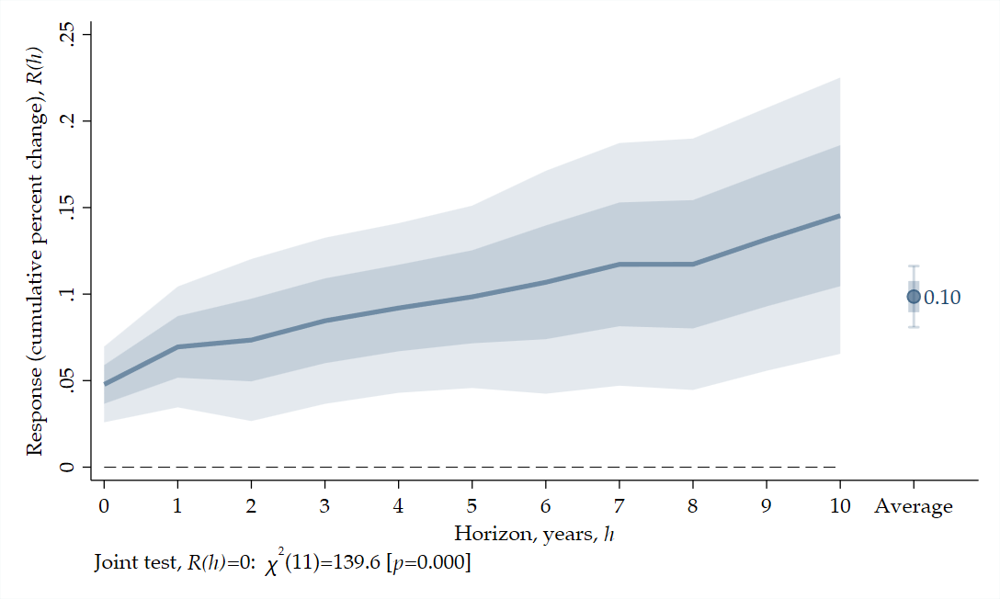{#fig-gdp-usd}

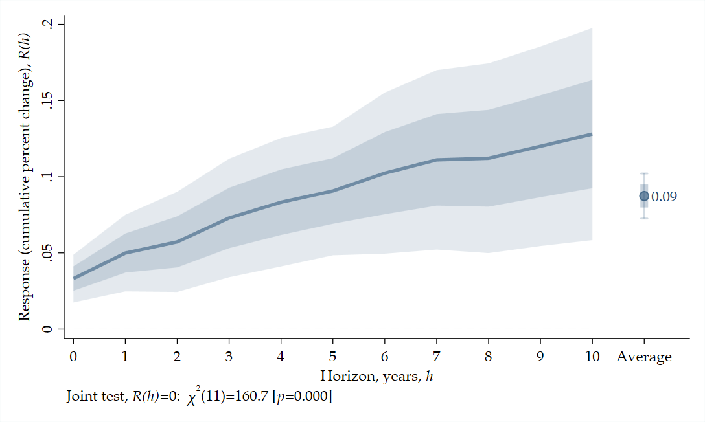{#fig-potential-gdp-usd}

Cumulative responses to age-related pension reforms: GDP and productive capacity
:::

::: {.fig-notes}
Notes: The dependent variable is the cumulative change in GDP and productive capacity—relative to $t{-}1$. Responses are normalized to a one-year increase in the statutory retirement age. The specification includes one lag of the dependent variable, contemporaneous values, and three lags of the old-age dependency ratio, the unemployment rate, the alternative (second) factor, and a crisis dummy, along with horizon-specific country and year fixed effects. Inferences based on bootstrapped standard errors (1000 replications). Wald test statistics for joint significance and $p$-values are reported below each chart. Darker (lighter) shaded areas indicate 68% (95%) pointwise confidence intervals.
:::

### Labour market outcomes {#sec-labour}

<!-- \textcolor{red}{! Attention IRFs Unemployment pour $h=0$}\\ --> <!-- JH and TG: what to do with that? -->

@fig-labour-age presents the labour market responses. The *Age* reform produces, as predicted, a large and statistically robust increase in the labour force participation rate of workers aged 55-64 (panel a). The response is significant within both the 68% and 95% confidence bands from horizon 1 onward, reaches a peak of +2.6 percentage points at horizons 5-6, and remains elevated throughout the ten-year window. This result aligns closely with Testable Implication [2](#ti2) and is consistent with the large related literature [@StaubliZweimuller2013; @GruberWise1999]: by raising the statutory retirement age, the reform mechanically extends the period of labour market attachment and strengthens the income motive to remain employed. The total labour force participation rate (panel b) also rises, with a more moderate but continuous effect (significant at 68%), reaching +0.8 pp at the 10^th^ year, consistent with the absence of crowding-out documented in the literature [@MunnellWu2012; @Dai2022]: older workers remaining in the labour market do not displace younger cohorts. The unemployment rate response (panel c) decreases in the short run, with a trough of about -1.5 pp at horizon 3, before becoming less precisely estimated thereafter. A potential explanation is that the transition dynamics noted in Testable Implication [2](#ti2) are more than offset by the expansionary impact on output previously highlighted.

A further implication of Testable Implication [2](#ti2), drawing on @BiZubairy2023, was that the sign of the Age reform’s effect on older workers’ participation could be ambiguous or even negative in the short run for reforms announced with long phase-in periods, due to the fiscal foresight and uncertainty channels. The finding that the LFPR response is positive from horizon 1 onward is therefore informative: it suggests that, in our sample, the labour-supply and income effects dominate any fiscal-foresight or uncertainty channel that could have induced early exits. This is consistent with the nature of the reforms contributing most to the Age factor (statutory retirement age increases applied without extended transition periods), and it corroborates the exogeneity argument developed in @sec-pcfa: the reforms we identify are structural in motivation and do not exhibit the very long implementation lags that @BiZubairy2023 associate with LFPR declines.

<!-- some workers who would have retired instead become or remain unemployed. -->

::: {#fig-labour-age layout-ncol=2}

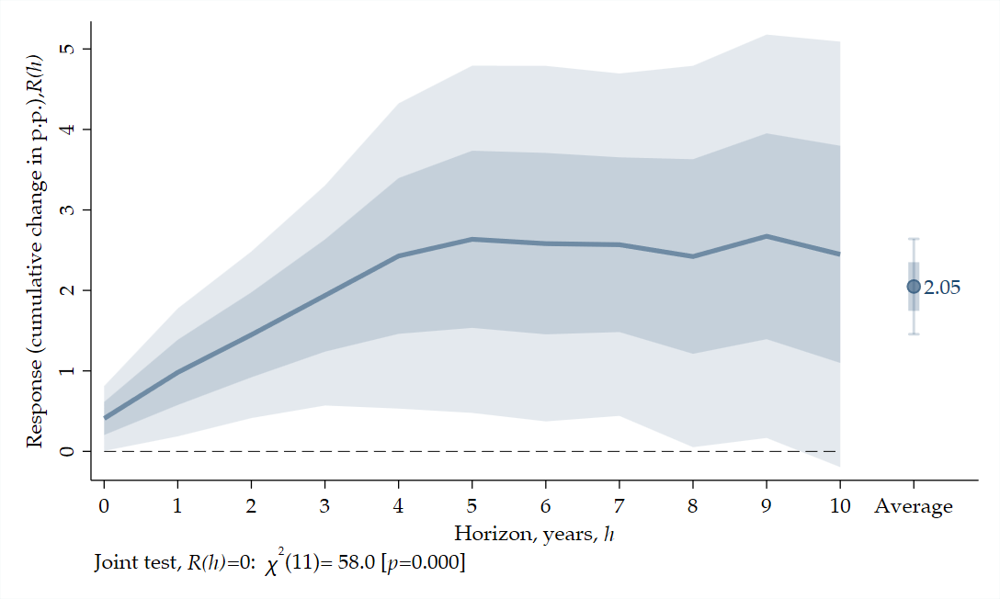{#fig-lfpr-older}

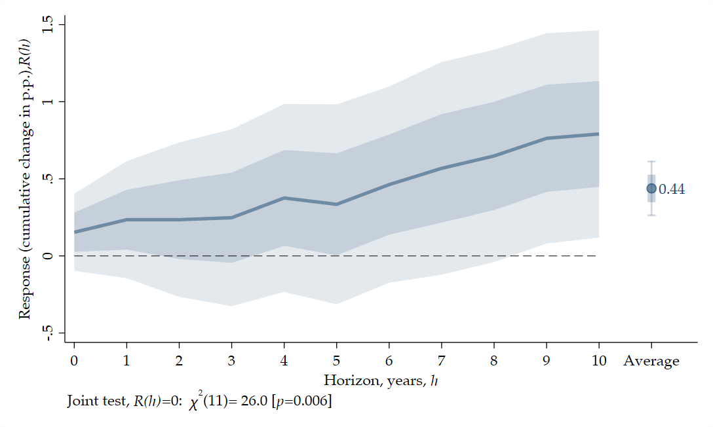{#fig-lfpr-total}

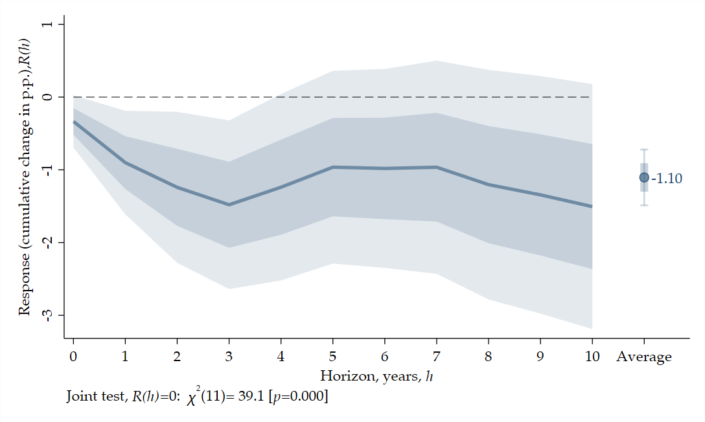{#fig-unemployment}

Cumulative responses to age-related pension reforms: labour market outcomes
:::

::: {.fig-notes}
Notes: The dependent variable is the cumulative change in labour market outcomes—relative to $t{-}1$. Responses are normalized to a one-year increase in the statutory retirement age. The specification includes one lag of the dependent variable, contemporaneous values, and three lags of the old-age dependency ratio, the unemployment rate, the alternative (second) factor, and a crisis dummy, along with horizon-specific country and year fixed effects. For the unemployment-rate regressions, the unemployment rate is excluded from the set of controls. Inferences based on bootstrapped standard errors (1000 replications). Wald test statistics for joint significance and $p$-values are reported below each chart. Darker (lighter) shaded areas indicate 68% (95%) pointwise confidence intervals.
:::

### Consumption and savings {#sec-conso}

::: {#fig-consumption-age layout-ncol=2}

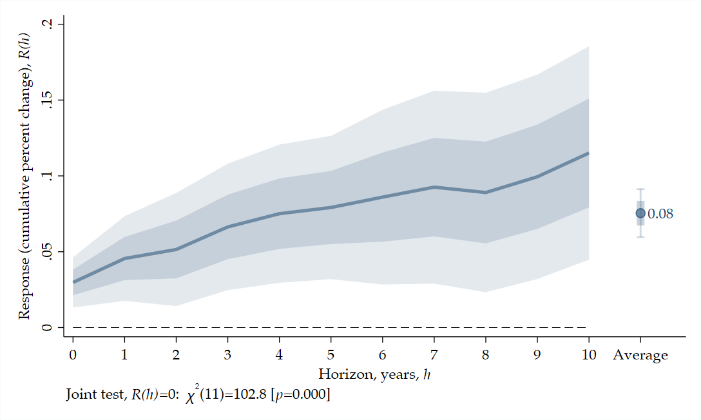{#fig-consumption-usd-age}

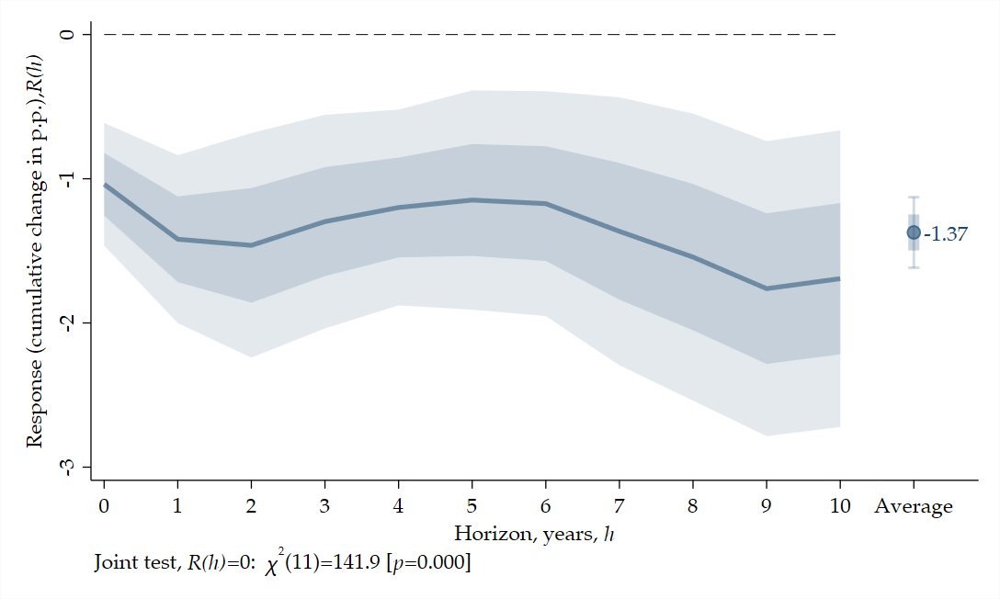{#fig-consumption-gdp-age}

Cumulative responses to age-related pension reforms: consumption
:::

::: {.fig-notes}
Notes: The dependent variable is the cumulative change in consumption—relative to $t{-}1$. Responses are normalized to a one-year increase in the statutory retirement age. The specification includes one lag of the dependent variable, contemporaneous values, and three lags of the old-age dependency ratio, the unemployment rate, the alternative factor, and a crisis dummy, along with horizon-specific country and year fixed effects. Inferences based on bootstrapped standard errors (1000 replications). Wald test statistics for joint significance and $p$-values are reported below each chart. Darker (lighter) shaded areas indicate 68% (95%) pointwise confidence intervals.
:::

@fig-consumption-age reports the consumption responses. The *Age* reform produces a positive and statistically significant increase in private consumption in absolute terms (panel a, average +0.08% in cumulative percent change, significant throughout). This result is in line with Testable Implication [4](#ti4) and validates the labour-income channel: workers who remain in employment instead of retiring continue to earn wages that substantially exceed their pension replacement income, thereby supporting aggregate consumption. As a share of GDP, however, consumption declines significantly (panel b, average -1.4 pp, -1.7 pp at the 10^th^ horizon), reflecting the fact that the reform raises GDP faster than it raises consumption — the labour supply expansion generates output growth that outpaces the demand effect, compressing the consumption-to-GDP ratio. This is consistent with the supply-side character of the Age reform documented in @sec-gdp.

::: {#fig-savings-age layout-ncol=2}

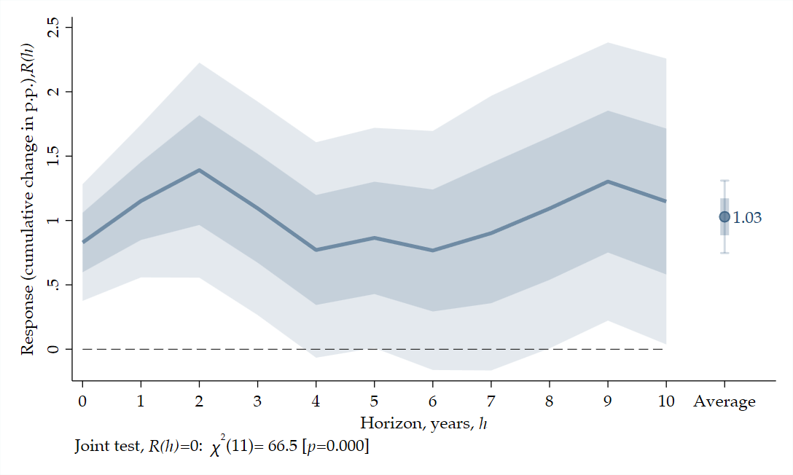{#fig-dom-savings-gdp-age}

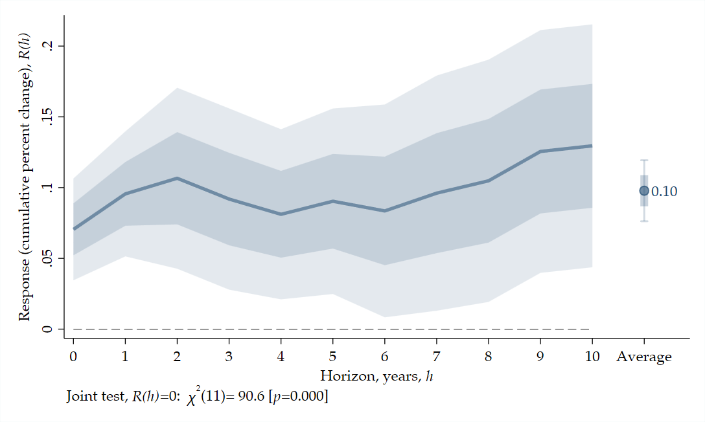{#fig-dom-savings-usd-age}

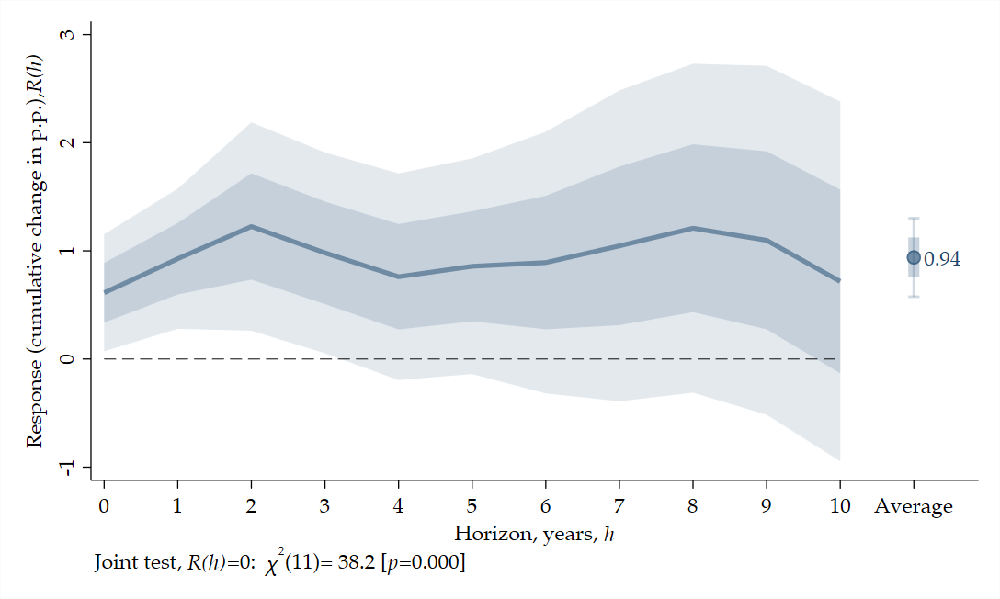{#fig-gross-savings-gdp-age}

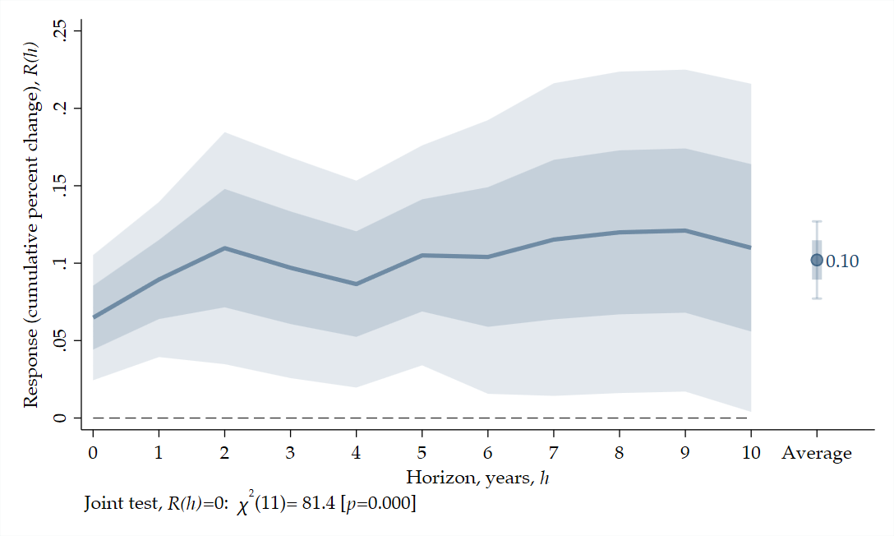{#fig-gross-savings-usd-age}

Cumulative responses to age-related pension reforms: savings
:::

::: {.fig-notes}
Notes: The dependent variable is the cumulative change in savings—relative to $t{-}1$. Responses are normalized to a one-year increase in the statutory retirement age. The specification includes one lag of the dependent variable, contemporaneous values, and three lags of the old-age dependency ratio, the unemployment rate, the alternative factor, and a crisis dummy, along with horizon-specific country and year fixed effects. Inferences based on bootstrapped standard errors (1000 replications). Wald test statistics for joint significance and $p$-values are reported below each chart. Darker (lighter) shaded areas indicate 68% (95%) pointwise confidence intervals.
:::

@fig-savings-age reports the savings responses, which provide the natural counterpart to the consumption results. Gross domestic savings rise clearly both in levels and as a share of GDP, with slightly weaker significance in the latter case. In levels (panel b), the response is positive, growing, and significant throughout the window, with an average of +0.10%. As a share of GDP (panel a), savings also rise, with an average of +1 pp. Gross savings tell a very similar story (panels c–d): significant positive response in levels (average +0.10%) and as a share of GDP (average +0.9 pp). Overall, the medium-to-long-run increase in savings as a share of GDP (mirroring the decrease of consumption as a share of GDP) is consistent with a life-cycle smoothing response.

<!-- paradox of thrift = increase in autonomous saving leads to a decrease in aggregate demand and thus a decrease in gross output which will in turn lower total saving -->

### Investment {#sec-invest}

[]{#sec:invest label="sec:invest"}

@fig-investment-age reports the investment responses. Consistently with Testable Implication [6](#ti6), the *Age* reform produces a positive and growing response throughout the window. In levels (panel a), investment rises from impact and is significant throughout, with an average of +0.11%. As a share of GDP (panel b), the response is also positive and significant, averaging +1.02 pp. Fixed investment (panels c–d) tells the same story: average +0.11% in levels and +0.88 pp as a share of GDP, both significant throughout the window. Notably, the positive response materialises from impact, without any short-run contraction. The profile is consistent with two medium-run channels. First, the labour-supply expansion raises the marginal product of capital and stimulates capital formation through capital-labour complementarity. Second, the improvement in fiscal ratios documented in @sec-fiscal may reduce expected public financing pressures and support private investment. Both channels build gradually, which helps explain the growing profile of the response.

::: {#fig-investment-age layout-ncol=2}

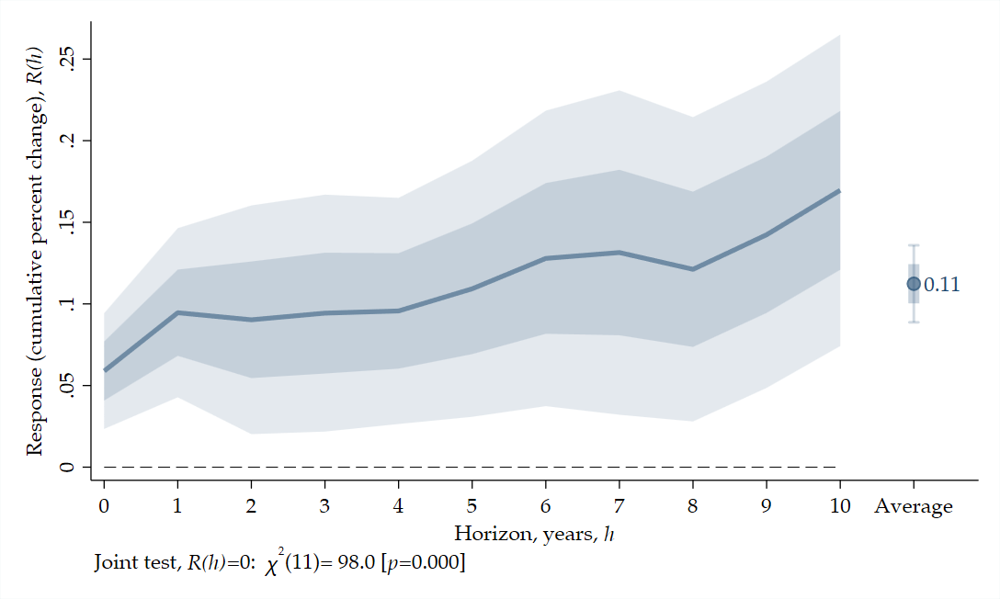{#fig-investment-usd-age}

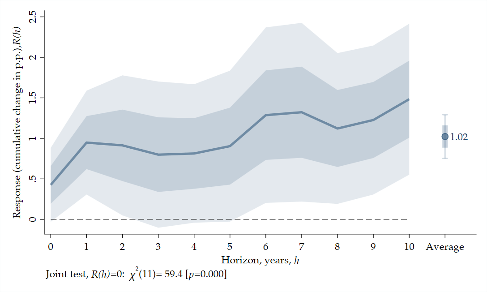{#fig-investment-gdp-age}

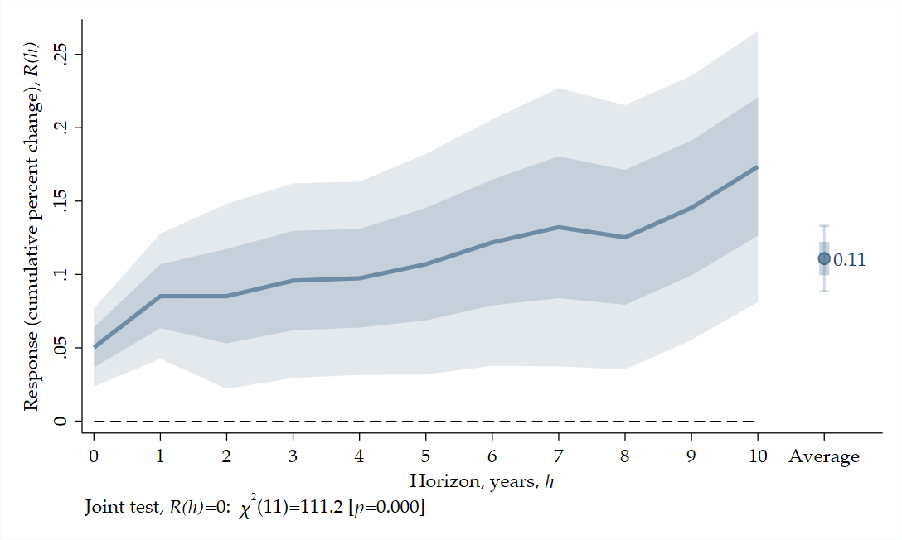{#fig-fixed-investment-usd-age}

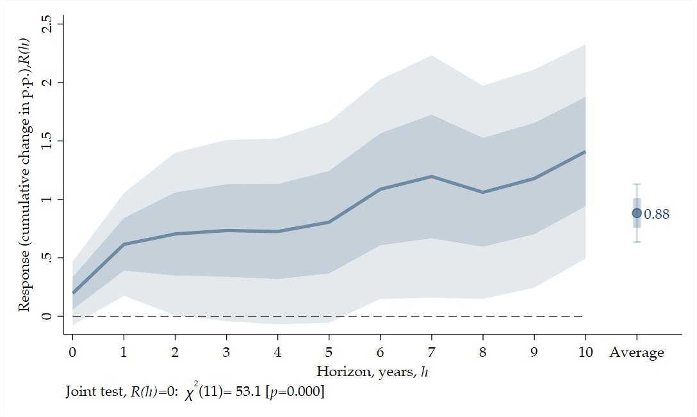{#fig-fixed-investment-gdp-age}

Cumulative responses to age-related pension reforms: investment
:::

::: {.fig-notes}
Notes: The dependent variable is the cumulative change in investment—relative to $t{-}1$. Responses are normalized to a one-year increase in the statutory retirement age. The specification includes one lag of the dependent variable, contemporaneous values, and three lags of the old-age dependency ratio, the unemployment rate, the alternative factor, and a crisis dummy, along with horizon-specific country and year fixed effects. Inferences based on bootstrapped standard errors (1000 replications). Wald test statistics for joint significance and $p$-values are reported below each chart. Darker (lighter) shaded areas indicate 68% (95%) pointwise confidence intervals.
:::

<!-- For capitalisation and investment:Testable Implication~\ref{test:inv} had left open the possibility of a neutral or negative short-run response if demand contracted before the fiscal consolidation channel took hold. -->

### Government debt and fiscal space {#sec-fiscal}

@fig-pension-exp-age reports the responses of pension and government expenditure, and @fig-gov-debt-age the debt responses <!-- , and Figure~\ref{fig:fig_capb} the cyclically adjusted primary balance (CAPB) --> .

The *Age* reform presents a striking fiscal picture. Public pension expenditure as a share of GDP declines significantly throughout the window (panel a of @fig-pension-exp-age, average −0.46 pp), consistent with delayed benefit eligibility and with the denominator effect generated by higher GDP. In constant USD, however, public pension expenditure is essentially unaffected — the response is quasi-zero and non-significant (panel b), suggesting that real pension spending is broadly unchanged while GDP rises, compressing the ratio. Central government expenditure in levels (panel d) rises modestly throughout (average +0.05%, weakly significant), consistent with the broader economic expansion documented in @sec-gdp, and the same pattern holds for general government expenditure (panel f, average +0.05%, significant throughout). As a share of GDP, however, central government expenditure is not significantly affected (panel c): the expansion in spending and the expansion in GDP broadly offset each other, leaving the expenditure ratio unchanged. General government expenditure (panel e) as a share of GDP delivers a message broadly similar, but with a more marked and significant decline (−0.58 pp).

Government debt tells a clear story (@fig-gov-debt-age): both central government debt (panel a, average −4.57 pp of GDP, significant at 68% throughout) and general government debt (panel b, average −5.46 pp of GDP, significant at 68% and 95% throughout) decline significantly and persistently. In constant USD, general government debt is non-significant (panel d), again reflecting the mechanical effect of GDP growth on the denominator: the debt ratio improves primarily because the economy grows, not because debt falls in absolute terms.

<!-- Despite this improvement in debt ratios, the CAPB deteriorates significantly (Figure~\ref{fig:fig_capb}, average $-$0.46~pp, significant at 68\% and 95\% throughout, trough around h=2- -3). This apparently paradoxical combination - -- falling debt ratios alongside a deteriorating structural balance - -- is consistent with the GDP growth documented in Section~\ref{sec:gdp} outpacing the fiscal deterioration: the denominator effect dominates the numerator effect on the debt ratio, even as the underlying fiscal position weakens. -->

<!-- The CAPB deteriorates significantly (Figure~\ref{fig:fig_capb}, average $-$0.46~pp, significant at 68\% and 95\% throughout, trough around h=2- -3). This result challenges the standard narrative of Age reforms as fiscal consolidation tools: within our estimation window, the reform does not improve the structural fiscal position. A plausible interpretation is that the demand expansion and higher government expenditure documented above outweigh the pension spending savings, deteriorating the primary balance before any longer-run fiscal dividend materialises. -->

::: {#fig-pension-exp-age layout-ncol=2}

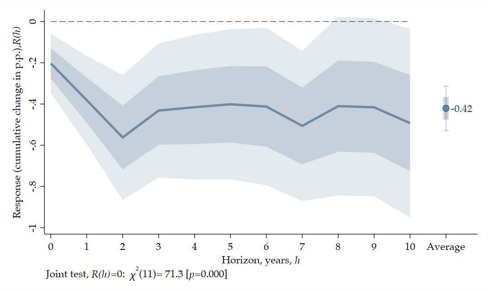{#fig-pension-exp-gdp-age}

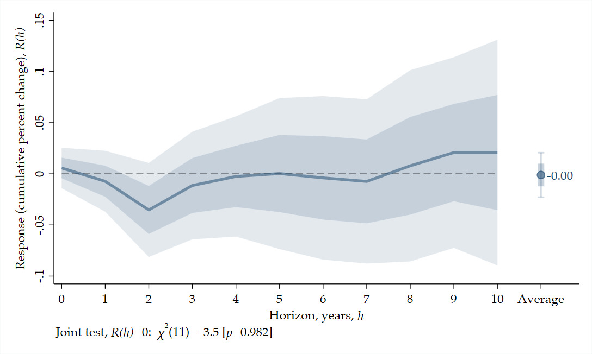{#fig-pension-exp-usd-age}

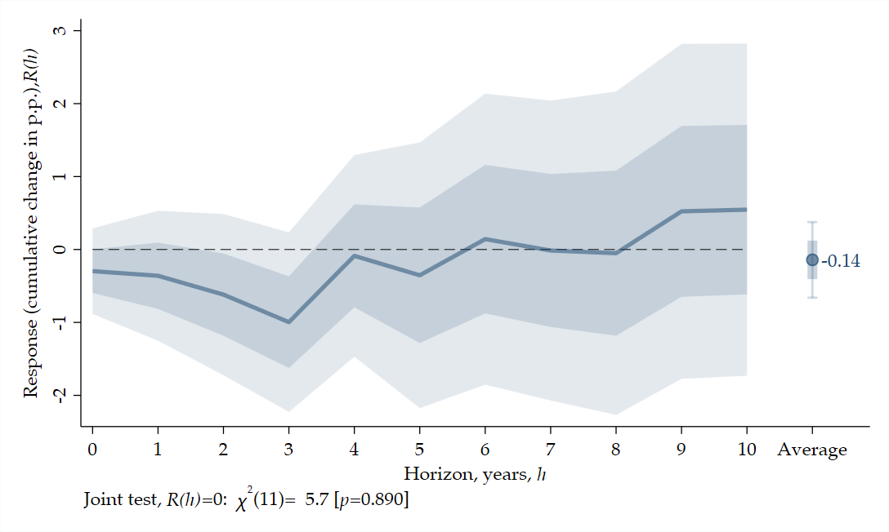{#fig-cg-exp-gdp-age}

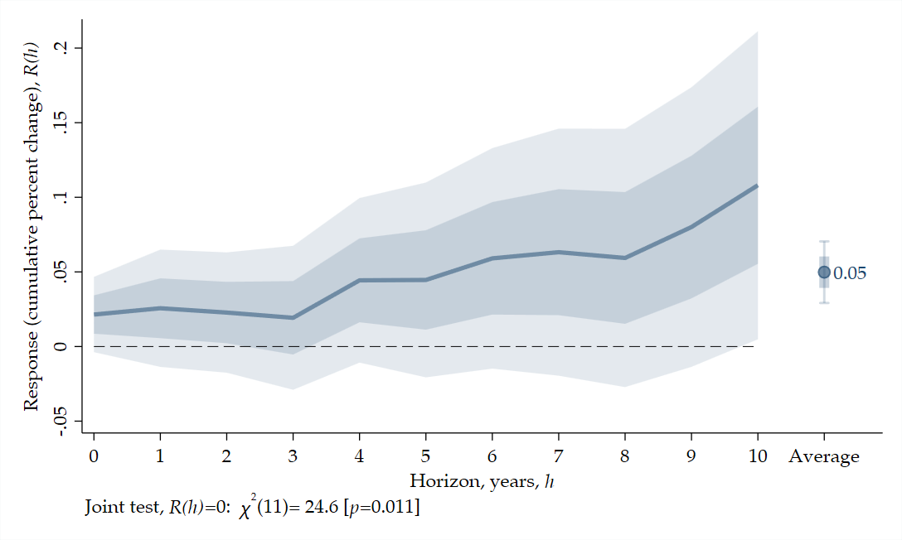{#fig-cg-exp-usd-age}

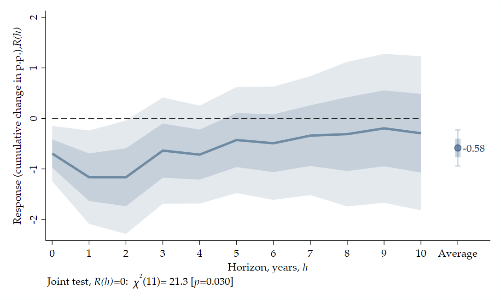{#fig-gg-exp-gdp-age}

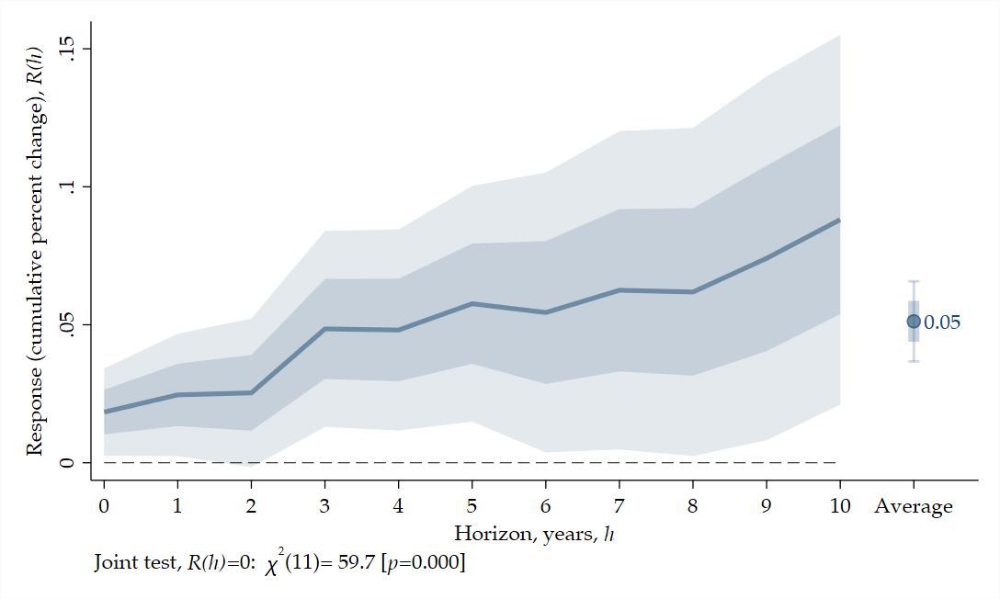{#fig-gg-exp-usd-age}

Cumulative responses to age-related pension reforms: pension and government expenditure
:::

::: {.fig-notes}
Notes: The dependent variable is the cumulative change in pension and government expenditure—relative to $t{-}1$. Responses are normalized to a one-year increase in the statutory retirement age. The specification includes one lag of the dependent variable, contemporaneous values, and three lags of the old-age dependency ratio, the unemployment rate, the alternative factor, and a crisis dummy, along with horizon-specific country and year fixed effects. Inferences based on bootstrapped standard errors (1000 replications). Wald test statistics for joint significance and $p$-values are reported below each chart. Darker (lighter) shaded areas indicate 68% (95%) pointwise confidence intervals.
:::

::: {#fig-gov-debt-age layout-ncol=2}

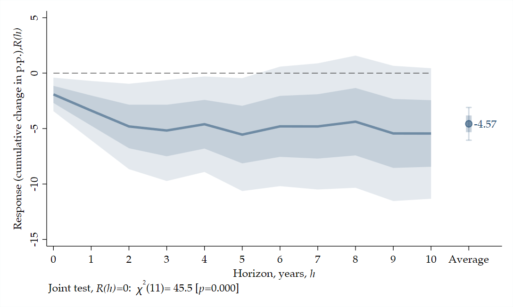{#fig-cg-debt-gdp-age}

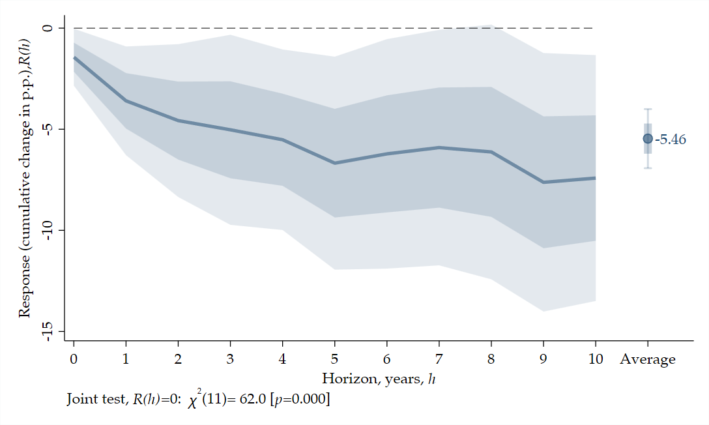{#fig-gg-debt-gdp-age}

{#fig-gg-debt-usd-age}

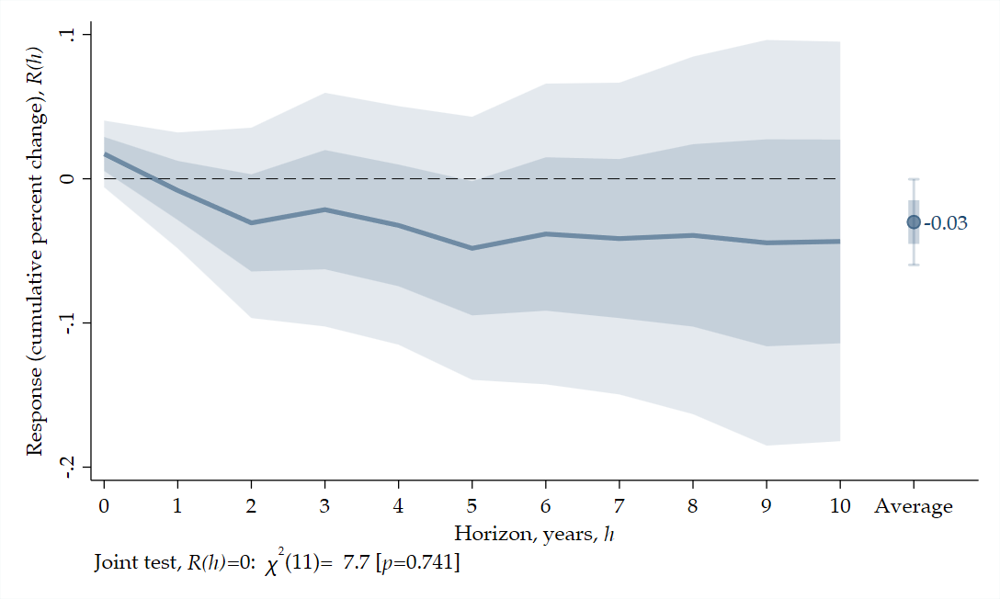{#fig-gg-debt-usd-age-b}

Cumulative responses to age-related pension reforms: government debt
:::

::: {.fig-notes}
Notes: The dependent variable is the cumulative change in government debt—relative to $t{-}1$. Responses are normalized to a one-year increase in the statutory retirement age. The specification includes one lag of the dependent variable, contemporaneous values, and three lags of the old-age dependency ratio, the unemployment rate, the alternative factor, and a crisis dummy, along with horizon-specific country and year fixed effects. Inferences based on bootstrapped standard errors (1000 replications). Wald test statistics for joint significance and $p$-values are reported below each chart. Darker (lighter) shaded areas indicate 68% (95%) pointwise confidence intervals.
:::

<!-- Disabled in LaTeX source (comment environment): figures/capb_gdp.png -->

<!-- Taken together, the fiscal results present a clear contrast: the \textit{Age} reform improves fiscal ratios mainly through higher GDP and lower pension expenditure relative to output, while the \textit{Capitalisation} reform reduces some expenditure aggregates in levels but raises debt ratios, consistent with transition costs and the adverse denominator effect of lower GDP. -->

### External sector {#sec-external}

@fig-trade-age and @fig-balances-age report the external sector responses, which we connect to Testable Implication [8](#ti8).

The *Age* reform produces an expansion of trade volumes in levels: both exports and imports rise over the estimation window (@fig-trade-age, panels a and c, average +0.04% for each), while their shares of GDP remain essentially unchanged (panels b and d). This pattern is consistent with the broad GDP expansion documented in @sec-gdp: the reform raises aggregate activity, increasing both export capacity and import demand in proportion to output. Consistently, neither the trade balance nor the current account balance shows a statistically significant response (@fig-balances-age, panels a–b). This result is in line with Testable Implication [8](#ti8): retirement-age reforms may raise trade volumes without necessarily altering the external balance when exports and imports move broadly together.

Overall, the external-sector results reinforce the broader pattern. The *Age* reform is associated with a balanced expansion of domestic activity and trade volumes, without significant external rebalancing.

::: {#fig-trade-age layout-ncol=2}

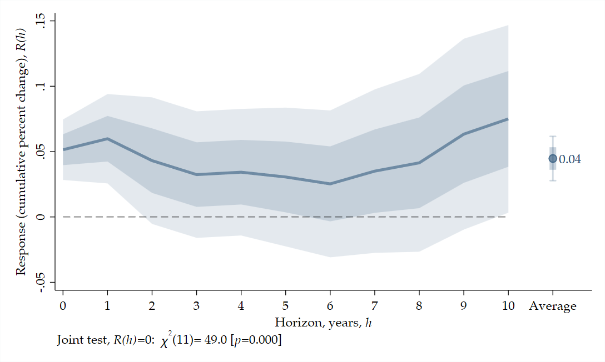{#fig-exports-usd-age}

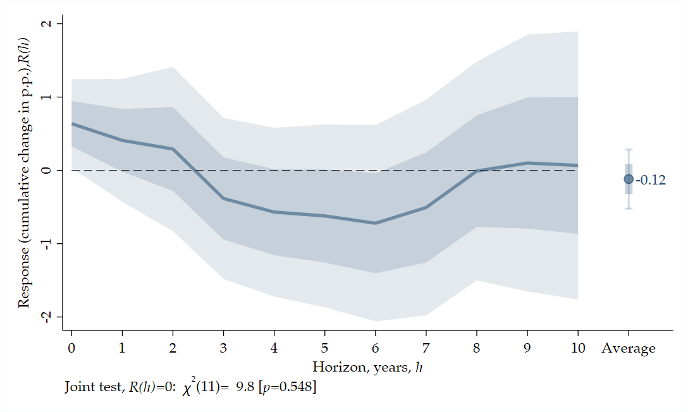{#fig-exports-gdp-age}

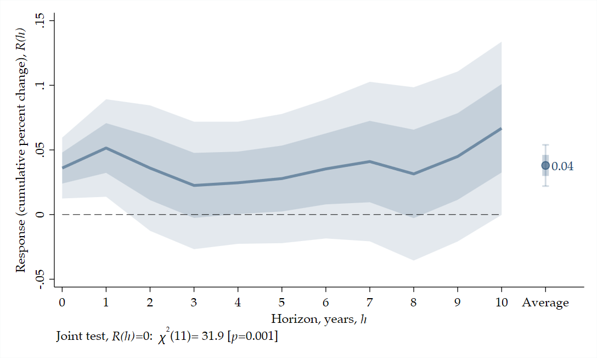{#fig-imports-usd-age}

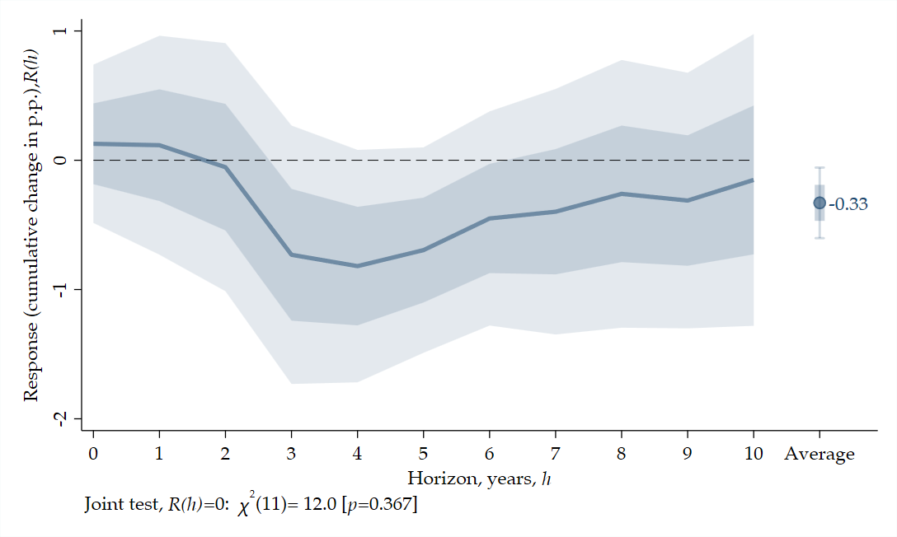{#fig-imports-gdp-age}

Cumulative responses to age-related pension reforms: trade flows
:::

::: {.fig-notes}
Notes: The dependent variable is the cumulative change in trade flows—relative to $t{-}1$. Responses are normalized to a one-year increase in the statutory retirement age. The specification includes one lag of the dependent variable, contemporaneous values, and three lags of the old-age dependency ratio, the unemployment rate, the alternative factor, and a crisis dummy, along with horizon-specific country and year fixed effects. Inferences based on bootstrapped standard errors (1000 replications). Wald test statistics for joint significance and $p$-values are reported below each chart. Darker (lighter) shaded areas indicate 68% (95%) pointwise confidence intervals.
:::

::: {#fig-balances-age layout-ncol=2}

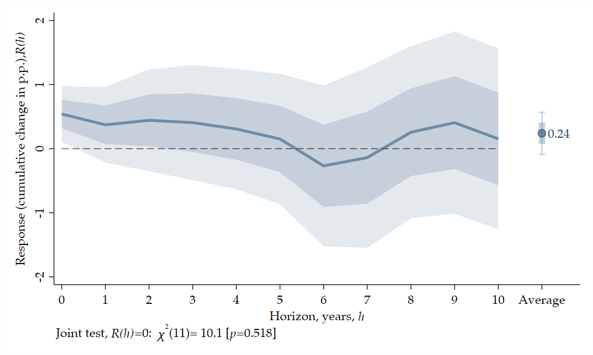{#fig-trade-balance-gdp-age}

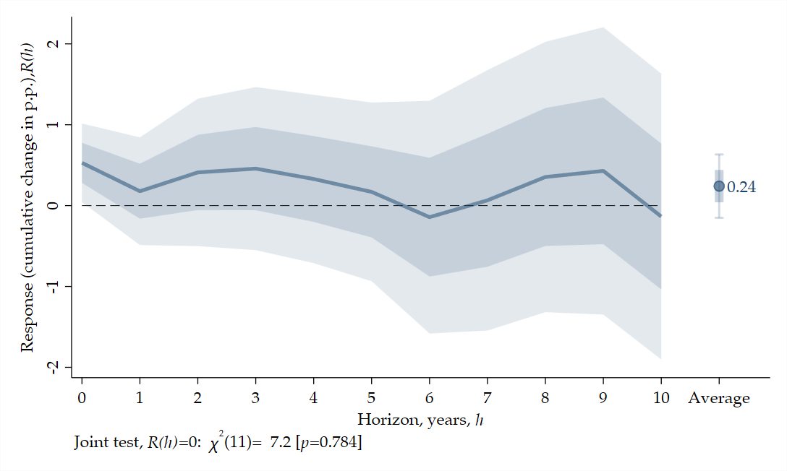{#fig-ca-balance-gdp-age}

Cumulative responses to age-related pension reforms: external balances
:::

::: {.fig-notes}
Notes: The dependent variable is the cumulative change in external balances—relative to $t{-}1$. Responses are normalized to a one-year increase in the statutory retirement age. The specification includes one lag of the dependent variable, contemporaneous values, and three lags of the old-age dependency ratio, the unemployment rate, the alternative factor, and a crisis dummy, along with horizon-specific country and year fixed effects. Inferences based on bootstrapped standard errors (1000 replications). Wald test statistics for joint significance and $p$-values are reported below each chart. Darker (lighter) shaded areas indicate 68% (95%) pointwise confidence intervals.
:::

<!-- By contrast, the \textit{Capitalisation} reform generates a contraction of trade volumes without producing the current-account improvement that would require a rise in national saving relative to investment. -->

### Productivity {#sec-prod}

[]{#sec:prod label="sec:prod"}

@fig-tfp-age reports the response of productivity, measured by TFP in panel (a) and GDP per worker in panel (b).

The *Age* reform is associated with a positive and jointly significant increase in TFP throughout the ten-year horizon (panel a). The response is positive on impact, at around +0.01%, builds gradually to approximately +0.02% at horizons 7-8, and remains above zero across the full window. GDP per worker also rises, with an average response of +0.03% (panel b), although significance quickly disappears (at $h=2$). Taken together, these results are broadly in line with the neutral-to-mildly-positive prediction of Testable Implication [9](#ti9). A plausible interpretation is that delayed retirement does not reduce average productivity and may instead generate complementarities through experience, firm-specific knowledge, and induced investment. This interpretation is consistent with the capital-skill complementarity channel highlighted by @Dai2022, but the aggregate TFP response should be interpreted cautiously, since it may also reflect broader general-equilibrium effects rather than the direct productivity effect of older workers alone.

::: {#fig-tfp-age layout-ncol=2}

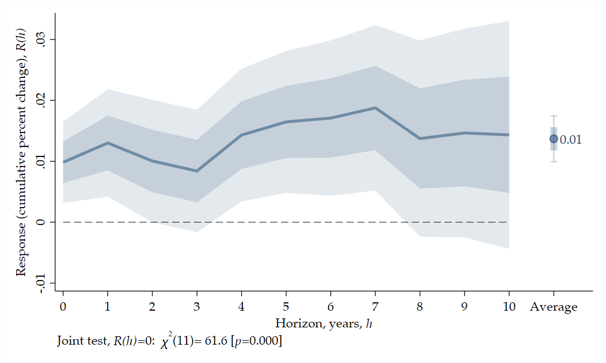{#fig-tfp-age-b}

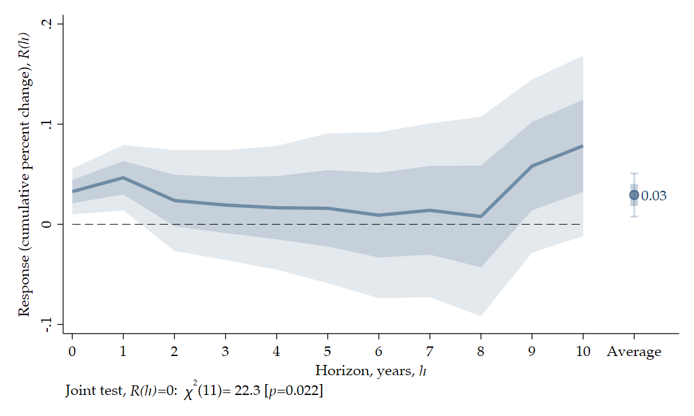{#fig-gdp-per-worker-age}

Cumulative responses to age-related pension reforms: productivity
:::

::: {.fig-notes}
Notes: The dependent variable is the cumulative change in total factor productivity (TFP) or GDP per worker —relative to $t{-}1$. Responses are normalized to a one-year increase in the statutory retirement age. The specification includes one lag of the dependent variable, contemporaneous values, and three lags of the old-age dependency ratio, the unemployment rate, the alternative factor, and a crisis dummy, along with horizon-specific country and year fixed effects. Inferences based on bootstrapped standard errors (1000 replications). Wald test statistics for joint significance and $p$-values are reported below each chart. Darker (lighter) shaded areas indicate 68% (95%) pointwise confidence intervals.
:::

## Additional results {#sec-more-results}

This section first presents suggestive results on the macro impacts of capitalisation reforms, then provides evidence on the savings outflow channel as a possible mechanism to rationalise their effects. Finally, we report several robustness checks, including a placebo analysis and controls for potentially omitted factors.

### Suggestive evidence on "capitalisation" reforms {#sec-suggestive-capi}

**GDP and productive capacity.** @fig-gdp shows that the Capitalisation factor is associated with a contractionary GDP profile. Real GDP responds negatively on impact and remains significantly negative throughout the entire ten-year window (panel a), with the response averaging -0.06%. There is no recovery within the estimation horizon. Potential GDP exhibits the same persistent contractionary pattern (panel b), with an average response of −0.04% and similarly strong significance. These results are consistent with the possibility that the diversion of contributions from consumption to private saving generates a demand contraction (as documented below in the consumption results) that depresses both actual and potential output persistently, with no sign of the capital accumulation channel reversing the effect within ten years. Although based on a limited number of reforms and countries, this pattern suggests that the standard prediction that pension privatization eventually raises productive capacity through higher savings and investment does not appear to materialise within the horizon covered by our analysis. This may reflect a longer transmission lag, a weak or incomplete capital market channel in our sample of countries, or structural features of the privatization reforms captured by the Capitalisation factor.

::: {#fig-gdp layout-ncol=2}

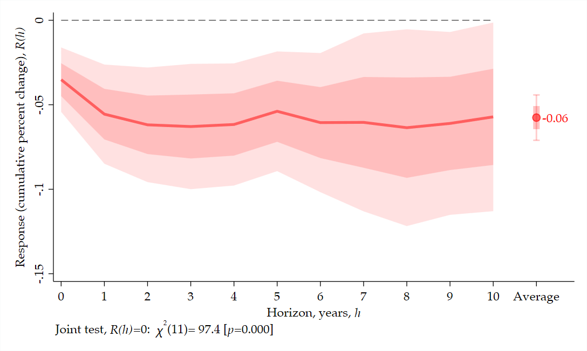{#fig-gdp-usd-b}

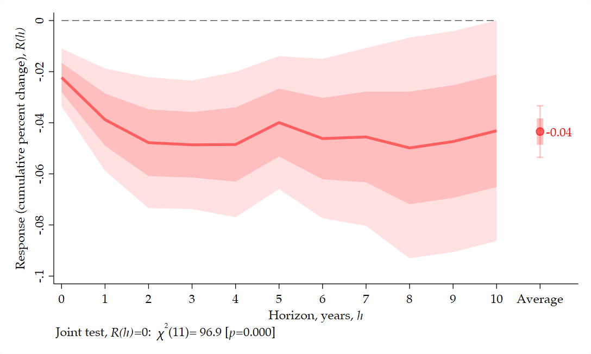{#fig-potential-gdp-usd-b}

Cumulative responses to capitalisation reforms: GDP and productive capacity
:::

::: {.fig-notes}
Notes: The dependent variable is the cumulative change in GDP and productive capacity—relative to $t{-}1$. Responses are normalized to a one-percentage-point increase in the contribution rate to private pension pillars. The specification includes one lag of the dependent variable, contemporaneous values, and three lags of the old-age dependency ratio, the unemployment rate, the age (first) factor, and a crisis dummy, along with horizon-specific country and year fixed effects. Inferences based on bootstrapped standard errors (1000 replications). Wald test statistics for joint significance and $p$-values are reported below each chart. Darker (lighter) shaded areas indicate 68% (95%) pointwise confidence intervals.
:::

**Labour market outcomes.** As shown in @fig-labour, the labour-market effects of the *Capitalisation* factor differ markedly from those associated with retirement-age reforms. The LFPR of older workers shows no significant response (panel a), consistent with Testable Implication [2](#ti2), which anticipated a weak and ambiguous effect of financing-structure reforms on retirement timing. Similarly, the aggregate participation rate is essentially unaffected (panel b). The unemployment rate, however, rises in a non-negligible manner in the short run (panel c). The response averages +0.37 pp over the estimation window, reaches a peak of +0.80 pp at horizon 3, and then gradually fades. This increase was not explicitly predicted for the *Capitalisation* reform, which was expected to have limited direct labour-market effects. A plausible interpretation is that the transition toward funded private accounts generates uncertainty and short-run adjustment costs, while the associated demand contraction may temporarily weaken labour demand. This can raise unemployment even if the reform has no direct effect on statutory retirement incentives. This interpretation is consistent with the broader uncertainty channel emphasised by @BiZubairy2023, although their mechanism was originally developed in the context of retirement-age reforms with long implementation lags. Overall, the labour-market results provide suggestive evidence that the *Capitalisation* factor has limited effects on participation, while potentially generating temporary unemployment through demand-compression and adjustment channels.

::: {#fig-labour layout-ncol=2}

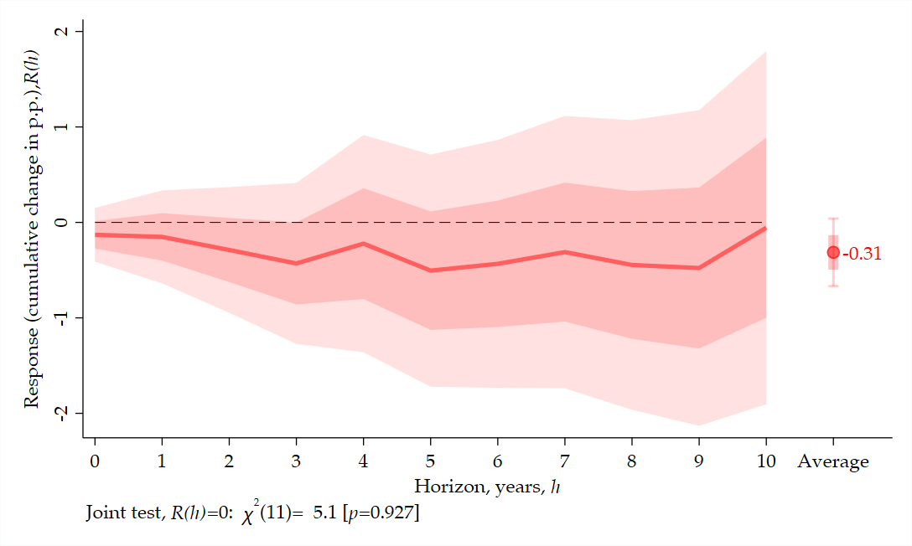{#fig-lfpr-older-b}

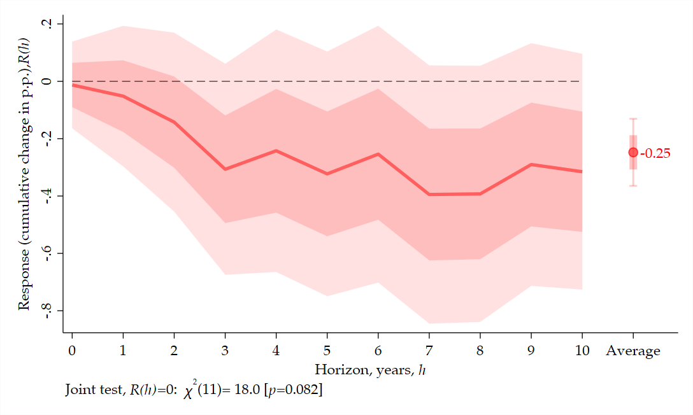{#fig-lfpr-total-b}

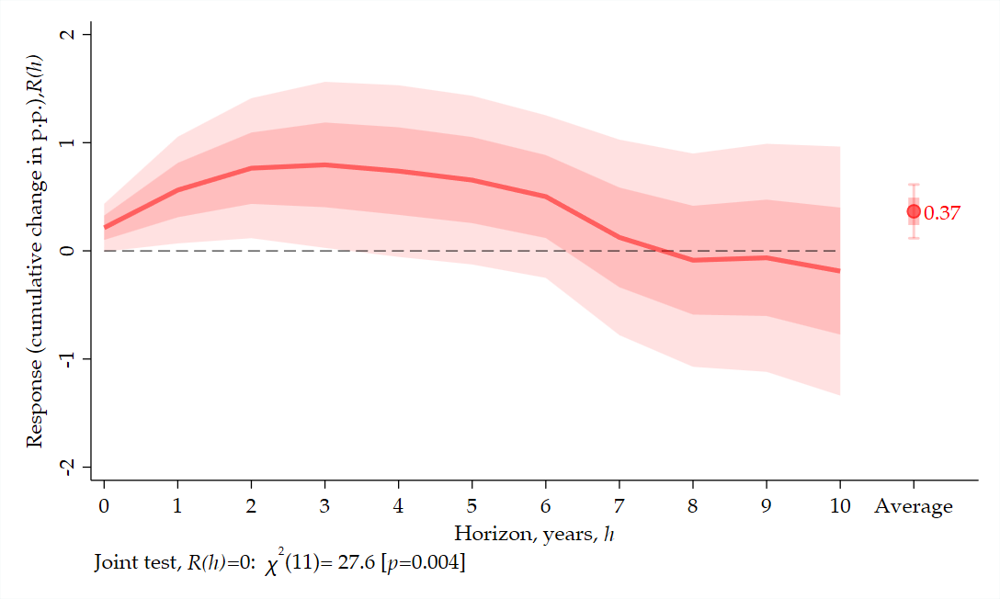{#fig-unemployment-b}

Cumulative responses to capitalisation reforms: labour market outcomes
:::

::: {.fig-notes}
Notes: The dependent variable is the cumulative change in labour market outcomes—relative to $t{-}1$. Responses are normalized to a one-percentage-point increase in the contribution rate to private pension pillars. The specification includes one lag of the dependent variable, contemporaneous values, and three lags of the old-age dependency ratio, the unemployment rate, the age (first) factor, and a crisis dummy, along with horizon-specific country and year fixed effects. For the unemployment-rate regressions, the unemployment rate is excluded from the set of controls. Inferences based on bootstrapped standard errors (1000 replications). Wald test statistics for joint significance and $p$-values are reported below each chart. Darker (lighter) shaded areas indicate 68% (95%) pointwise confidence intervals.
:::

**Consumption and savings.** @fig-consumption shows that the *Capitalisation* factor is associated with a markedly different consumption pattern from that observed for retirement-age reforms. Private consumption falls significantly in absolute terms across the entire ten-year window (panel a, average −0.05%, significant throughout), with no sign of recovery. As a share of GDP, however, consumption is *positive* up to horizon 3–4 before reverting toward zero (panel b, average +0.26 pp). This apparently paradoxical combination — consumption falling in levels but rising as a share of GDP — reflects the fact that the Capitalisation reform compresses GDP proportionally more than it compresses consumption (as documented previously in the paragraph “GDP and productive capacity”), raising the consumption share mechanically. This pattern is consistent with a current-demand compression channel: the redirection of contributions toward private funded accounts may reduce consumption in levels, while the associated GDP contraction mechanically raises the consumption-to-GDP ratio.

::: {#fig-consumption layout-ncol=2}

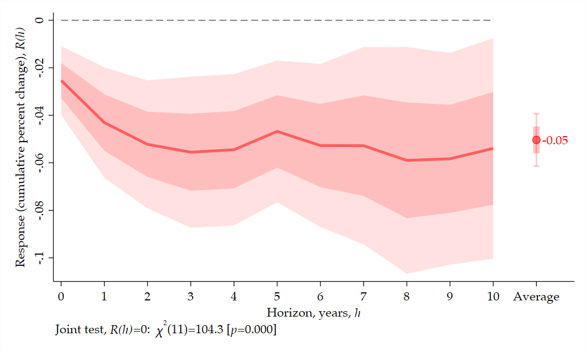{#fig-consumption-usd}

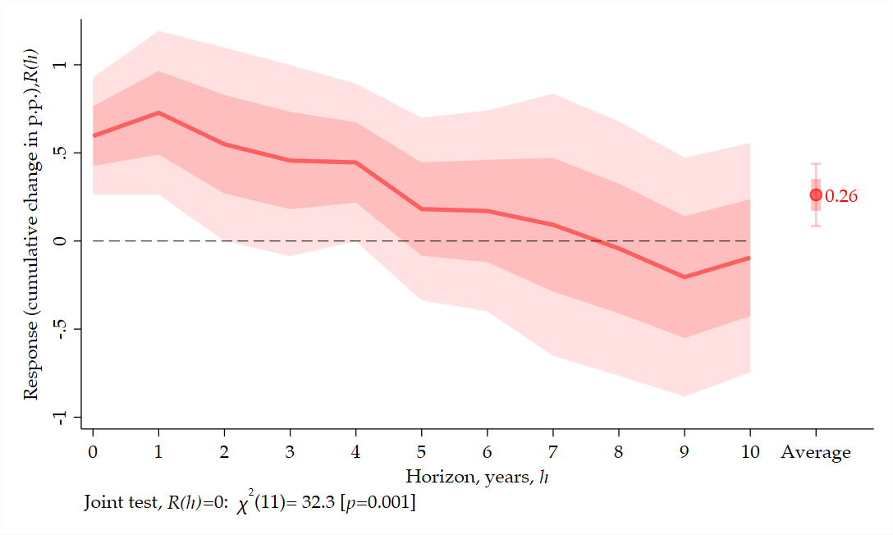{#fig-consumption-gdp}

Cumulative responses to capitalisation reforms: consumption
:::

::: {.fig-notes}
Notes: The dependent variable is the cumulative change in consumption—relative to $t{-}1$. Responses are normalized to a one-percentage-point increase in the contribution rate to private pension pillars. The specification includes one lag of the dependent variable, contemporaneous values, and three lags of the old-age dependency ratio, the unemployment rate, the age (first) factor, and a crisis dummy, along with horizon-specific country and year fixed effects. Inferences based on bootstrapped standard errors (1000 replications). Wald test statistics for joint significance and $p$-values are reported below each chart. Darker (lighter) shaded areas indicate 68% (95%) pointwise confidence intervals.
:::

@fig-savings reports the corresponding savings responses. For the *Capitalisation* factor, the savings picture is contrasted. In levels, gross domestic savings fall significantly throughout the window (panel b, average −0.06%), mirroring the GDP contraction documented above in the paragraph on GDP and productive capacity: lower output mechanically reduces aggregate savings in levels. As a share of GDP, gross domestic savings also decline over horizons 0–4 before reverting toward zero (panel a, average −0.34 pp). Gross savings in levels display a similar pattern (panel d, average −0.06%), while gross savings as a share of GDP are not jointly significant (panel c). Taken together, these results suggest that the *Capitalisation* factor is not associated with an increase in aggregate saving rates. A standard argument in favour of funded pension schemes holds that mandatory private pension contributions should raise saving and, eventually, investment. Our results are instead consistent with a demand-compression mechanism: higher contributions may increase saving at the household level, but the associated contraction in aggregate demand and output may compress household incomes broadly, offsetting the saving gains of contributors and preventing any increase in aggregate saving at the macroeconomic level. This interpretation remains suggestive, however, since our aggregate saving measures do not separately identify mandatory private pension contributions from other forms of saving.

::: {#fig-savings layout-ncol=2}

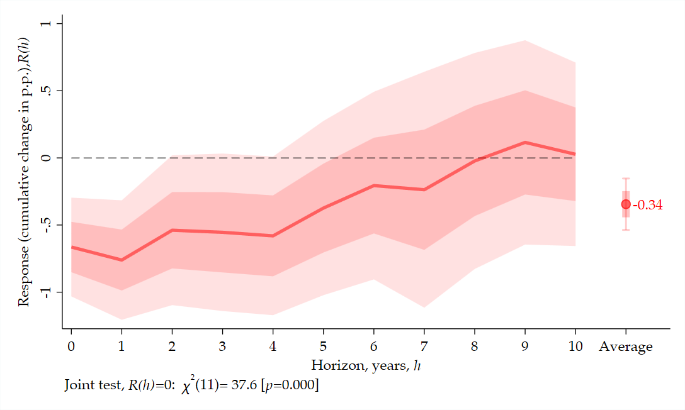{#fig-dom-savings-gdp}

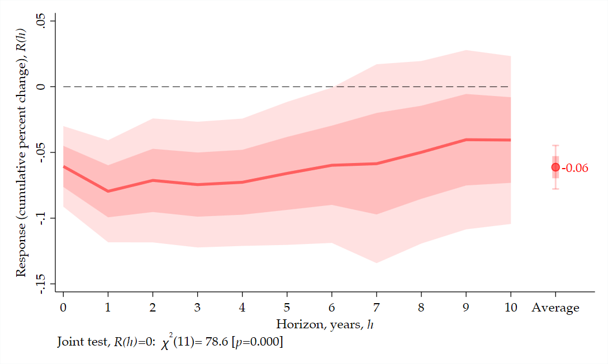{#fig-dom-savings-usd}

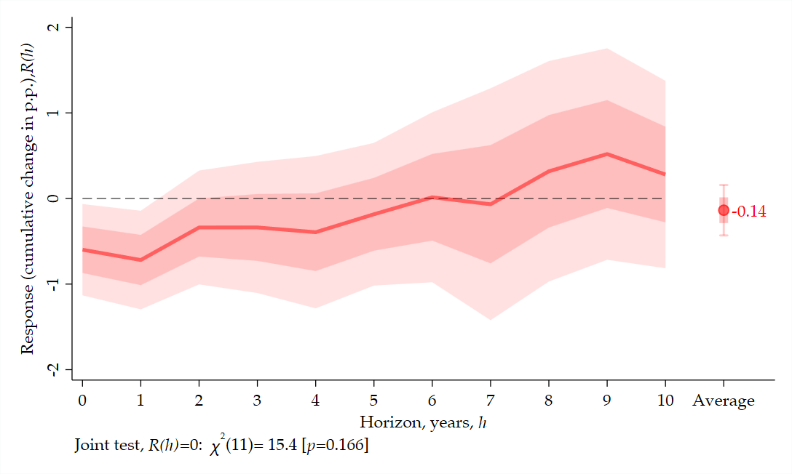{#fig-gross-savings-gdp}

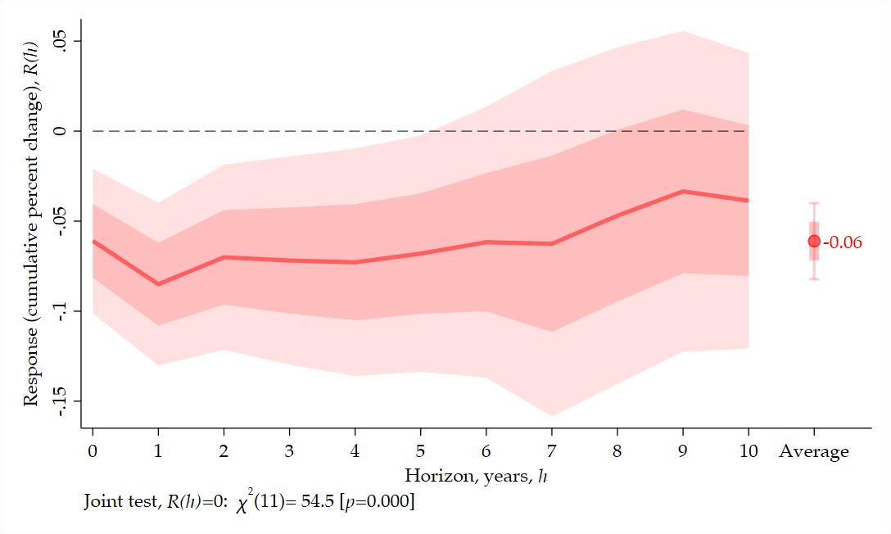{#fig-gross-savings-usd}

Cumulative responses to capitalisation reforms: savings
:::

::: {.fig-notes}
Notes: The dependent variable is the cumulative change in savings—relative to $t{-}1$. Responses are normalized to a one-percentage-point increase in the contribution rate to private pension pillars. The specification includes one lag of the dependent variable, contemporaneous values, and three lags of the old-age dependency ratio, the unemployment rate, the age (first) factor, and a crisis dummy, along with horizon-specific country and year fixed effects. Inferences based on bootstrapped standard errors (1000 replications). Wald test statistics for joint significance and $p$-values are reported below each chart. Darker (lighter) shaded areas indicate 68% (95%) pointwise confidence intervals.
:::

**Investment.** The *Capitalisation* factor is associated with a long-lasting negative investment response (@fig-investment) — a result that contrasts with the theoretical prediction of a positive capital market channel. In levels (panel a), investment falls throughout the window, with an average of −0.06%, significant on most horizons. As a share of GDP (panel b), the response is negative and significant over horizons 0–7, before reverting toward zero, with an average of −0.42 pp. Fixed investment mirrors this pattern (panels c–d): average −0.06% in levels and −0.23 pp as a share of GDP, with a trough around h=4–5 before partial recovery. Testable Implication [6](#ti6) had left open the possibility of a neutral or negative short-run response if demand contracted before the fiscal consolidation channel took hold. However, the standard prediction — that private pension contributions flow into capital markets and stimulate investment over the medium-to-long run — does not materialise within our estimation window. Instead, the demand contraction associated with the Capitalisation factor appears to dominate, depressing investment through a standard accelerator mechanism. Whether the capital market channel eventually prevails beyond the ten-year horizon covered here remains an open question, but within this window the Capitalisation factor is associated with persistently negative investment responses.

::: {#fig-investment layout-ncol=2}

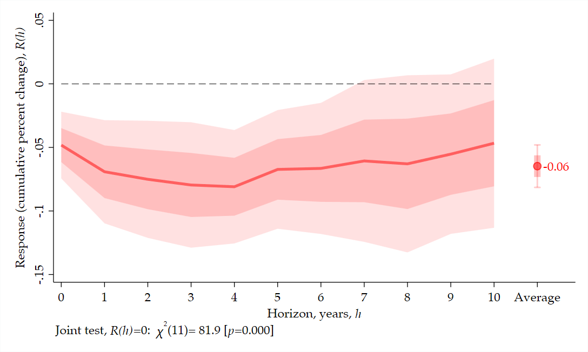{#fig-investment-usd}

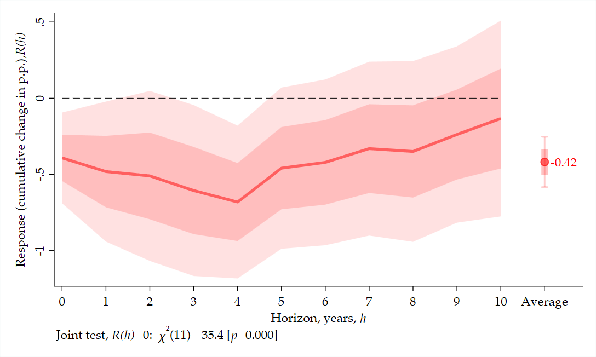{#fig-investment-gdp}

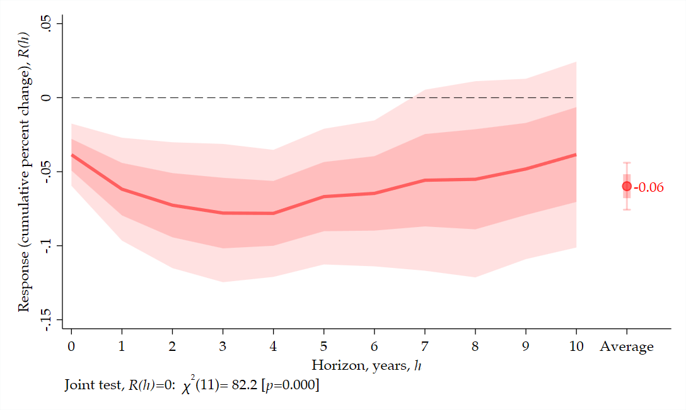{#fig-fixed-investment-usd}

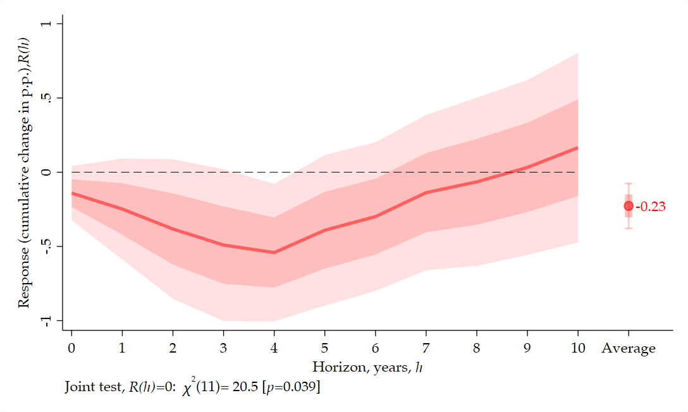{#fig-fixed-investment-gdp}

Cumulative responses to capitalisation reforms: investment
:::

::: {.fig-notes}
Notes: The dependent variable is the cumulative change in investment—relative to $t{-}1$. Responses are normalized to a one-percentage-point increase in the contribution rate to private pension pillars. The specification includes one lag of the dependent variable, contemporaneous values, and three lags of the old-age dependency ratio, the unemployment rate, the age (first) factor, and a crisis dummy, along with horizon-specific country and year fixed effects. Inferences based on bootstrapped standard errors (1000 replications). Wald test statistics for joint significance and $p$-values are reported below each chart. Darker (lighter) shaded areas indicate 68% (95%) pointwise confidence intervals.
:::

**Government debt and fiscal space.** @fig-pension-exp reveals a consistent pattern for the *Capitalisation* reform: expenditure falls in levels but expenditure ratios do not. In constant USD, public pension expenditure declines significantly throughout the window (panel b, average −0.04%), and central and general government expenditure follow the same pattern (panels d and f, average −0.03%). As shares of GDP, however, none of these series decline: the pension-to-GDP ratio is essentially unchanged (panel a, not jointly significant), while central and general government expenditure ratios actually rise (panels c and e, average +0.54 pp and +0.71 pp). This apparent paradox reflects the sharp GDP contraction documented above: as the denominator shrinks, expenditure ratios rise mechanically even as spending falls in levels.

::: {#fig-pension-exp layout-ncol=2}

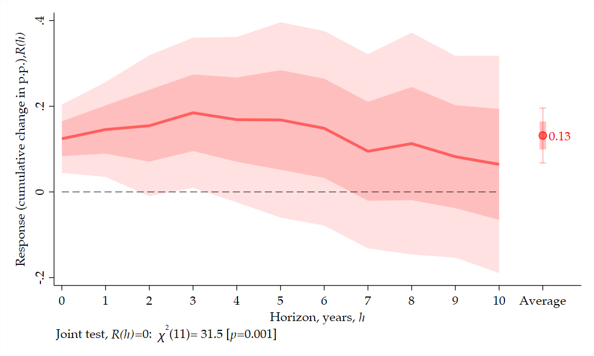{#fig-pension-exp-gdp}

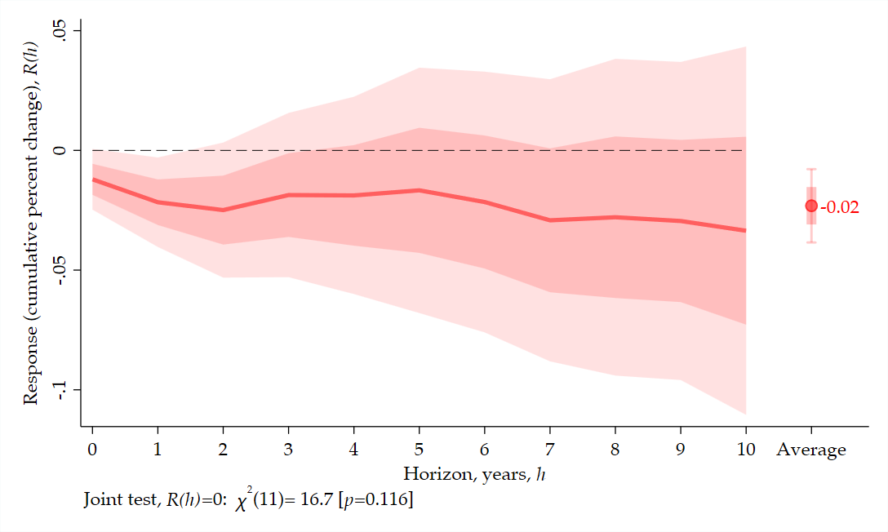{#fig-pension-exp-usd}

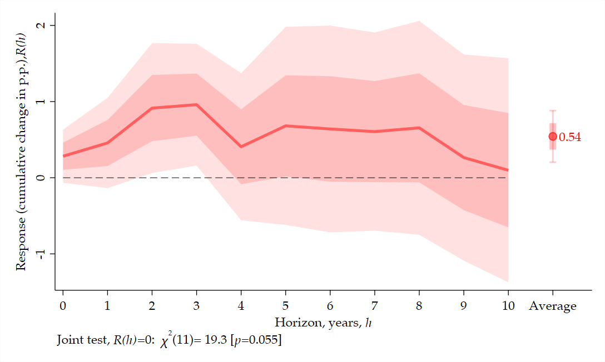{#fig-cg-exp-gdp}

{#fig-cg-exp-usd}

{#fig-gg-exp-gdp}

{#fig-gg-exp-usd}

Cumulative responses to capitalisation reforms: pension and government expenditure
:::

::: {.fig-notes}
Notes: The dependent variable is the cumulative change in pension and government expenditure—relative to $t{-}1$. Responses are normalized to a one-percentage-point increase in the contribution rate to private pension pillars. The specification includes one lag of the dependent variable, contemporaneous values, and three lags of the old-age dependency ratio, the unemployment rate, the age (first) factor, and a crisis dummy, along with horizon-specific country and year fixed effects. Inferences based on bootstrapped standard errors (1000 replications). Wald test statistics for joint significance and $p$-values are reported below each chart. Darker (lighter) shaded areas indicate 68% (95%) pointwise confidence intervals.
:::

Government debt presents a contrasting picture (@fig-gov-debt): both central government debt (panel a, average +2.42 pp of GDP) and general government debt (panel b, average +3.72 pp of GDP) increase and are statistically different from zero at the 68% confidence level. This pattern is consistent with the transition-cost channel associated with pension privatization: as contributions are redirected toward private accounts, governments may need to continue financing existing pay-as-you-go obligations while part of the contribution base is shifted away from the public system, generating additional borrowing needs in the short to medium run. In constant USD, general and central government debts are not statistically significant (panels c–d), suggesting that the increase in debt ratios partly reflects the adverse denominator effect of the GDP contraction previously documented. <!-- The CAPB is essentially unaffected and not jointly significant (Figure~\ref{fig:fig_capb}, average $+$0.03~pp), confirming that the Capitalisation reform does not generate measurable structural fiscal consolidation within the estimation window. -->

::: {#fig-gov-debt layout-ncol=2}

{#fig-cg-debt-gdp}

{#fig-gg-debt-gdp}

{#fig-gg-debt-usd}

{#fig-gg-debt-usd-b}

Cumulative responses to capitalisation reforms: government debt
:::

::: {.fig-notes}
Notes: The dependent variable is the cumulative change in government debt—relative to $t{-}1$. Responses are normalized to a one-percentage-point increase in the contribution rate to private pension pillars. The specification includes one lag of the dependent variable, contemporaneous values, and three lags of the old-age dependency ratio, the unemployment rate, the age (first) factor, and a crisis dummy, along with horizon-specific country and year fixed effects. Inferences based on bootstrapped standard errors (1000 replications). Wald test statistics for joint significance and $p$-values are reported below each chart. Darker (lighter) shaded areas indicate 68% (95%) pointwise confidence intervals.
:::

**External sector.** As shown in @fig-trade and @fig-balances, the *Capitalisation* factor is associated with a different external-sector profile. Export and import volumes decline over the estimation window (@fig-trade, panels a and c, average -0.03% and -0.04%, respectively), mirroring the GDP contraction previously documented. As aggregate activity contracts, both export supply and import demand fall in level terms, while their shares of GDP remain broadly stable (panels b and d). Importantly, neither the trade balance nor the current account balance improves significantly (@fig-balances, panels a–b). This contrasts with the theoretical possibility described in Testable Implication [8](#ti8): funded pension reforms could improve the current account if they raised national saving relative to investment. The results suggest that this saving-investment channel does not materialise within the ten-year horizon. A plausible explanation is that the saving rate does not rise, as previously documented, so the mechanism through which the current account could improve is absent.

::: {#fig-trade layout-ncol=2}

{#fig-exports-usd}

{#fig-exports-gdp}

{#fig-imports-usd}

{#fig-imports-gdp}

Cumulative responses to capitalisation reforms: trade flows
:::

::: {.fig-notes}
Notes: The dependent variable is the cumulative change in trade flows—relative to $t{-}1$. Responses are normalized to a one-percentage-point increase in the contribution rate to private pension pillars. The specification includes one lag of the dependent variable, contemporaneous values, and three lags of the old-age dependency ratio, the unemployment rate, the age (first) factor, and a crisis dummy, along with horizon-specific country and year fixed effects. Inferences based on bootstrapped standard errors (1000 replications). Wald test statistics for joint significance and $p$-values are reported below each chart. Darker (lighter) shaded areas indicate 68% (95%) pointwise confidence intervals.
:::

::: {#fig-balances layout-ncol=2}

{#fig-trade-balance-gdp}

{#fig-ca-balance-gdp}

Cumulative responses to capitalisation reforms: external balances
:::

::: {.fig-notes}
Notes: The dependent variable is the cumulative change in external balances—relative to $t{-}1$. Responses are normalized to a one-percentage-point increase in the contribution rate to private pension pillars. The specification includes one lag of the dependent variable, contemporaneous values, and three lags of the old-age dependency ratio, the unemployment rate, the age (first) factor, and a crisis dummy, along with horizon-specific country and year fixed effects. Inferences based on bootstrapped standard errors (1000 replications). Wald test statistics for joint significance and $p$-values are reported below each chart. Darker (lighter) shaded areas indicate 68% (95%) pointwise confidence intervals.
:::

**Productivity.** The *Capitalisation* factor, by contrast, is associated with a negative response in both productivity indicators (@fig-tfp). TFP declines from impact, reaches a trough around horizons 1–3, and gradually reverts toward zero by horizons 4–5, leaving the average response close to zero over the full window (panel a). GDP per worker exhibits a more severe and persistent contraction, averaging −0.06% and remaining significantly below zero across most of the ten-year window (panel b). These results partly diverge from Testable Implication [9](#ti9), which allowed for a negative short-run effect and a positive longer-run effect if funded pension savings translated into capital deepening. A plausible interpretation is that the demand contraction associated with the *Capitalisation* factor depresses output and investment while labour input adjusts only gradually. This mechanically lowers GDP per worker and may also weigh on measured TFP through lower capacity utilization or weaker investment in productivity-enhancing capital. The persistence of the negative GDP-per-worker response suggests that the capital-accumulation channel does not materialise within the ten-year horizon of our analysis.

::: {#fig-tfp layout-ncol=2}

{#fig-tfp-b}

{#fig-gdp-per-worker}

Cumulative responses to capitalisation reforms: productivity
:::

::: {.fig-notes}
Notes: The dependent variable is the cumulative change in total factor productivity (TFP) or GDP per worker —relative to $t{-}1$. Responses are normalized to a one-percentage-point increase in the contribution rate to private pension pillars. The specification includes one lag of the dependent variable, contemporaneous values, and three lags of the old-age dependency ratio, the unemployment rate, the age (first) factor, and a crisis dummy, along with horizon-specific country and year fixed effects. Inferences based on bootstrapped standard errors (1000 replications). Wald test statistics for joint significance and $p$-values are reported below each chart. Darker (lighter) shaded areas indicate 68% (95%) pointwise confidence intervals.
:::

### Saving outflows and capitalisation reforms {#sec-outflows}

Results in @sec-suggestive-capi point to an overall contractionary pattern associated with the Capitalisation factor, operating through both supply and demand. We now provide suggestive evidence on a possible channel underlying these results. @fig-savingsout-gdp and @fig-savingsout-invest report, respectively, the responses of GDP (real and potential) and investment (in real terms and as a share of GDP) for two subsamples split at the median of the ratio of foreign assets to gross domestic savings. Foreign assets are defined as the sum of the stocks of portfolio equity assets, portfolio debt assets, other investment assets, and FDI assets.[^7] This indicator provides a proxy for the extent to which domestic savings are invested abroad rather than in the domestic economy.

[^7]: Data are from @Lane_MF_2018.

The depressing effects are concentrated exclusively in observations above the median. Real GDP decreases significantly over the entire horizon, by 0.06% on average, and most of this contraction stems from potential GDP, which shrinks by 0.05% on average. This erosion of potential output is consistent with the negative response of investment, both in real terms (-0.08% on average) and as a share of GDP (-0.78 pp on average for total investment and -0.64 pp for fixed investment). Conversely, no significant effect emerges, for either GDP or investment, in observations below the median. Overall, these results show that the negative responses associated with the Capitalisation factor are concentrated in observations with higher foreign asset holdings relative to domestic savings. This pattern is consistent with the hypothesis that the domestic benefits of higher pension savings are weaker when a larger share of savings is invested abroad.

<!-- L’indicateur est le ratio des foreign assets sur le gross domestic savings. --> <!-- Foreign assets = Portfolio equity assets stock + Portfolio debt assets --> <!-- + Other investment assets + FDI assets stock. Les données sur les foreign --> <!-- assets viennent de la Lane et Milesi-Ferretti (The external wealth of nations --> <!-- database, https://www.brookings.edu/articles/the-external-wealth-of-nations-database/). -->

::: {#fig-savingsout-gdp layout-ncol=2}

{#fig-savingsout-gdp-1}

{#fig-potgdp-savingsout}

Cumulative responses to capitalisation reforms by level of saving outflows: GDP and productive capacity
:::

::: {.fig-notes}
Notes: The dependent variable is the cumulative change in real GDP and potential GDP —relative to $t-1$. Responses are normalized to a one-percentage-point increase in the contribution rate to private pension pillars. The specification includes one lag of the dependent variable, contemporaneous values, and three lags of the old-age dependency ratio, the unemployment rate, the age (first) factor, and a crisis dummy, along with horizon-specific country and year fixed effects. Inferences based on bootstrapped standard errors (1000 replications). Wald test statistics for joint significance and $p$-values are reported below each chart. Darker (lighter) shaded areas indicate 68% (95%) pointwise confidence intervals.
:::

::: {#fig-savingsout-invest layout-ncol=2}

{#fig-savingsout-invest-1}

{#fig-invgdp-savingsout}

{#fig-savingsout-invest-3}

{#fig-finvgdp-savingsout}

Cumulative responses to capitalisation reforms by level of saving outflows: investment
:::

::: {.fig-notes}
Notes: The dependent variable is the cumulative change in investment—relative to $t{-}1$. Responses are normalized to a one-percentage-point increase in the contribution rate to private pension pillars. The specification includes one lag of the dependent variable, contemporaneous values, and three lags of the old-age dependency ratio, the unemployment rate, the age (first) factor, and a crisis dummy, along with horizon-specific country and year fixed effects. Inferences based on bootstrapped standard errors (1000 replications). Wald test statistics for joint significance and $p$-values are reported below each chart. Darker (lighter) shaded areas indicate 68% (95%) pointwise confidence intervals.\
:::

### Robustness checks

<!-- \sout{In the Online Appendix \ref{sec: OA}, we provide the results of various sensitivity exercises. }\\ --> This section presents robustness analyses aimed at strengthening the causal interpretation of our findings along four dimensions: falsification (placebo) tests, controls for concurrent fiscal adjustments, spillovers and external pressures, and uncertainty. Each addresses a distinct identification threat: spurious relationships, omitted-variable bias from concurrent fiscal consolidations, contamination through spillovers or external pressures, and the possibility that economic uncertainty — domestic or foreign — surrounding the reforms may itself affect the outcomes of interest.

**Falsification tests.** Are our results merely artefacts, or could they arise by chance? We investigate this question through a falsification exercise. More specifically, we conduct permutation-based placebo tests in which reform shocks are randomly reassigned across country-year observations and the local projections are re-estimated. The exercise can be interpreted as a Monte Carlo permutation test: rather than drawing artificial shocks from a parametric distribution, we permute the observed reform shocks in order to preserve the empirical distribution of our reform measures. This is important because pension reforms are discrete, infrequent, and unevenly distributed across countries and years, and are therefore not well approximated by standard parametric distributions. The procedure breaks the link between the actual timing of reforms and subsequent macroeconomic outcomes, while keeping the distribution of reform shocks unchanged. For each horizon, we provide ridgeline plots reporting the empirical distribution of impulse responses obtained from 1000 permutations. If the baseline estimates reflect the actual timing of pension reforms rather than a mechanical feature of the estimation procedure, randomly reassigned reform shocks should not generate systematic response patterns.

The resulting placebo distributions are reported in [Appendix Figure 1](annexes.html#fig-placebos). Overall, the distributions appear centered around zero and do not display systematic dynamic patterns across horizons. This supports the interpretation that the baseline results are not driven mechanically by the estimation procedure or by the unconditional distribution of reform shocks.

<!-- Besides, since Australia accounts for a significant number of capitalisation reforms episodes, we rerun estimates on a sample excluding Australia, in order to be sure this country does not drive the results reported in section \ref{sec:suggestive_capi}. Results are reported in Online Appendix XXX, and show no difference with our main estimates. -->

<!-- XXX CARL: Insert graphs capi without Australia XXX -->

**Additional control for fiscal adjustments.** We do control for business cycles at various stages of our empirical exercise: firstly, in the conditional factor analysis, by adjusting variables for GDP growth ; secondly, by including unemployment rate and a crisis dummy in the set of regressors in the local projections. However, in order to be sure our estimates do not confound pension reforms with coinciding fiscal consolidations, we include, as an additional precaution, explicit measures of fiscal consolidations based on the narrative dataset by @GLP_austerity_2014.

More specifically, our baseline LP specification is extended to include, contemporaneously and with up to three lags, three alternative measures of fiscal consolidation: (i) the overall size of the fiscal consolidation, (ii) the associated spending cuts, and (iii) the corresponding tax increases. Despite the loss of observations due to the more limited time coverage of these measures –up to 2019–, results reported on [Appendix Figure 2](annexes.html#fig-fiscalconsolidation) remain highly consistent with our previous findings, qualitatively identical and quantitatively very close.

**Spillovers and external pressure.** Our specifications include country fixed effects and year dummies. While the latter capture common dynamics across countries, they do not account for the possibility that exogenous foreign developments affect country-specific dynamics. For instance, pension reforms enacted abroad may raise expectations of similar reforms at home, with macroeconomic effects that would then be wrongly attributed to domestic dynamics.

To control for such spillovers and this “external reform pressure”, we augment the baseline LP specification with the leave-one-out means of our age and funded-pension reform measures, as well as the leave-one-out mean of an indicator for reform-voting years, both contemporaneously and with up to three lags. Results, reported in [Appendix Figure 3](annexes.html#fig-externalpressure), are virtually indistinguishable from the baseline.

<!-- Dans le même ordre d'idée, tester une sorte de "reform-thy-neighbor", i.e., je fini par réformer parce que mes voisins géographiques (ou les économies similaires, etc) réforment.\\ ! Couvre aussi l'endogénéité: peut affecter à la fois la proba de réformer et nos variables macro. (spillovers: reforme et macro) \\S -->

**Uncertainty.** In a similar vein, pension reforms are often hotly debated and sometimes trigger social unrest, which may disrupt the implementation of the reforms as initially planned. The resulting uncertainty may significantly affect our macroeconomic outcome variables. We therefore augment the baseline LP specification with controls for uncertainty based on Google Trends data, which are only available from 2004 onwards. Specifically, we include, both contemporaneously and with up to three lags, the domestic Google Trends index (as a measure of domestic uncertainty) and its leave-one-out mean (as a measure of foreign uncertainty). <!-- quel(s) terme(s) de recherche Google Trends utilise-t-on (« pension reform » ?) dans la langue locale ? -->

Results are reported in [Appendix Figure 4](annexes.html#fig-uncertainty). They are fairly noisy, owing to the smaller post-2004 sample. Nonetheless, they are qualitatively close to the baseline, with no systematic difference in the direction of the responses.

<!-- - régression capitalisation sur l'échantillon réduit (on enlève tous les pays qui n'ont pas de pilier public), --> <!-- \textbf{En cours}\\ --> <!-- XXX CARL: Insert graphs for results on the pure private pillar sample. XXX -->

<!-- - régression réforme d'âge sur l'échantillon symétrique au précédent (on enlève tous les pays qui n'ont pas de pilier privé), --> <!-- \textbf{En cours}\\ --> <!-- XXX CARL: Insert graphs for results on the pure private pillar sample. XXX\\ -->

<!-- All last robustness: PIB réel, PIB pot, conso \\ --> <!-- Pour réforme d'age: + labor force participation 55-64 \\ --> <!-- Pour réfomre Capi: + Invest \\ -->

## Conclusion {#sec-conclusion}

Population ageing places advanced economies under increasing pressure to reform their pension systems. Yet pension reforms are not homogeneous policy shocks. They differ in the instruments they use, in the timing of their implementation, and in the macroeconomic channels through which they operate. This paper has studied the dynamic macroeconomic effects of pension reforms by combining a new narrative database of major pension reforms in 17 OECD countries over the period 1980-2025 with a conditional factor-analysis approach and local projections.

Our first contribution is to construct reform measures that capture not only the occurrence of pension reforms but also their magnitude and gradual implementation path, going beyond standard dummy-based approaches. Our second contribution is to summarise the multidimensional structure of pension reforms into two orthogonal dimensions: the *Age* factor, which captures increases in statutory or early-retirement ages, and the *Capitalisation* factor, which is related to shifts toward funded private pension schemes. Because the latter is identified from a smaller and more geographically concentrated set of reform episodes, the main analysis focuses on the *Age* factor, while results for the *Capitalisation* factor are interpreted as complementary and more suggestive evidence.

The main results show that reforms delaying retirement generate a broad expansionary response. They raise the labour force participation rate of workers aged 55-64 and increase aggregate labour force participation. They also increase real GDP and potential GDP, suggesting that the output gains are not merely cyclical but reflect an expansion of productive capacity. Consumption and investment rise in levels, and investment also increases as a share of GDP. On the fiscal side, public pension expenditure declines as a share of GDP and government debt ratios fall persistently. These results suggest that retirement-age reforms should not be interpreted as standard fiscal retrenchment shocks. Rather, they operate as positive labour-supply shocks that also generate demand effects through higher labour income <!-- : workers who remain employed longer receive wages that typically exceed the pension benefits they would otherwise have obtained, supporting household consumption and firms' investment decisions --> .

The complementary results on the *Capitalisation* factor point to a different pattern, but should be interpreted more cautiously. In our sample, the *Capitalisation* factor is associated with declines in GDP, consumption, investment, and GDP per worker over the ten-year horizon considered. Although public pension expenditure falls in levels, debt ratios increase, consistent with transition costs and the adverse denominator effect of lower GDP. We do not find evidence, within this horizon, that the *Capitalisation* factor is associated with a rise in aggregate saving or investment. Instead, the results are more consistent with a demand-compression channel and fiscal transition costs that may outweigh any positive capital-accumulation effect in the medium run. In this regard, we find that the negative responses are concentrated in observations with higher foreign asset holdings relative to domestic savings, a pattern consistent with a possible role for savings outflows.

The main findings on retirement-age reforms are robust to various sensitivity checks. The results have two broader implications. First, the macroeconomic effects of pension reforms depend crucially on the instrument used. Treating all pension retrenchments as equivalent fiscal consolidation measures risks obscuring important differences between reforms that expand labour supply and reforms that alter pension financing arrangements. Second, the design and timing of reforms matter. Retirement-age reforms can improve both growth and fiscal sustainability when the labour-supply and labour-income channels dominate anticipation and adjustment effects. The results on capitalisation reforms suggest that shifts toward funded schemes may entail transition costs and contractionary demand effects, especially if higher private pension contributions do not translate into higher national saving and productive investment. <!-- \textcolor{red}{/!\textbackslash} \sout{This latter conclusion, however, remains more tentative given the smaller number of capitalisation reform episodes.} -->

Several caveats are warranted. Our results may depend on country-specific features — labour-market institutions, pension-system credibility, financial-market depth — and the evidence on capitalisation reforms rests on a more limited set of reform episodes. The ten-year horizon may also be insufficient to capture the full effects of funded schemes on capital accumulation. Future research could examine heterogeneity across institutional settings and assess whether capitalisation reforms deliver different outcomes over longer horizons or under deeper financial markets.

Overall, the paper shows that pension reforms have macroeconomic effects that go well beyond their direct impact on pension expenditure. The main evidence indicates that delaying retirement can simultaneously support output, investment, and fiscal sustainability by expanding labour supply and sustaining labour income. Complementary evidence for the *Capitalisation* factor suggests that a greater reliance on funded private pensions does not necessarily deliver the expected macroeconomic gains within the horizon studied here. The choice of pension reform instrument is therefore central to understanding the macroeconomic consequences of ageing and the policy trade-offs involved in restoring pension-system sustainability.

## References {.unnumbered}
